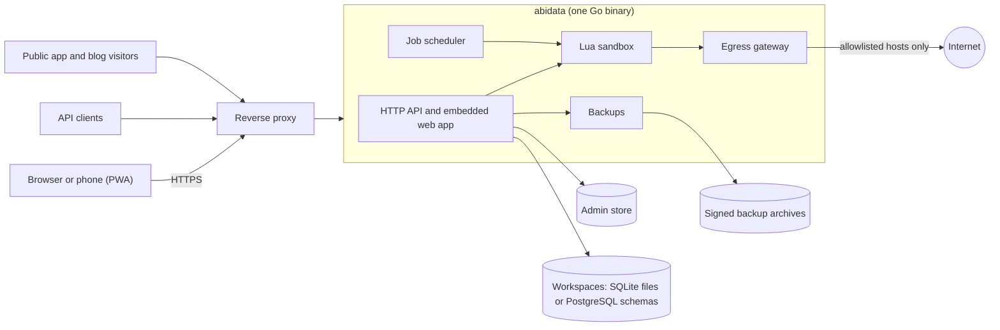

<div align="center">

# AbiData

**A self-hosted data workspace: datasheets, queries, forms, reports, Lua scripts and jobs, in one Go binary.**

[](https://github.com/AbishYoung/AbiData/actions/workflows/ci.yml)
[](https://github.com/AbishYoung/AbiData/releases)
[](LICENSE)
[](https://abishyoung.github.io/AbiData/)

[Website](https://abishyoung.github.io/AbiData/) ·
[Documentation](https://abishyoung.github.io/AbiData/docs/) ·
[Quick start](#quick-start) ·
[Releases](https://github.com/AbishYoung/AbiData/releases)

<picture>
  <source media="(prefers-color-scheme: dark)" srcset="docs/images/datasheet-orders-dark.jpg">
  
</picture>

</div>

AbiData is an open-source database application platform for teams, in the spirit of Microsoft Access, built for the web. You design tables, queries, forms, reports and scripts in the browser, and the people you invite use them from a laptop or a phone. Everything for one project lives in a **workspace**, which is a SQLite file by default or a schema in your PostgreSQL database.

It ships as one Go binary with the React web app embedded, or as a container image. You run it on your own server, and your data stays there.

## What you can build

| | |
|---|---|
| **Datasheets** | Typed fields, lookups, calculated columns, validation, record history with field-by-field merge of conflicting edits, keyboard-driven editing, and CSV, Excel or JSON import and export. |
| **Queries** | A visual designer for joins, criteria and totals, and a read-only SQL editor with parameters and execution limits. |
| **Forms and reports** | A canvas form designer with subforms and Lua event handlers. Banded reports with grouping and totals, with server-side PDF output. |
| **Maps and files** | Location and Area fields with maps, photo and file attachments, and GPS capture on phones. |
| **Lua scripts and jobs** | Sandboxed Lua 5.1 with memory and CPU limits, run from forms and reports or on a cron schedule, with an egress allowlist for outbound requests. |
| **Public apps and blogs** | Publish forms and reports behind an unguessable link with no accounts, and give every user a Markdown blog with an Atom feed. |
| **Teams** | Viewer, editor, builder and owner roles per workspace, direct and workspace messages, live updates, scoped API keys and signed backups. |
| **Mobile and access** | An installable PWA with touch-friendly record cards, a command palette, and light and dark themes. Aimed at WCAG 2.1 AA ([ACCESSIBILITY.md](ACCESSIBILITY.md)). |

<table>
  <tr>
    <td></td>
    <td></td>
    <td></td>
  </tr>
  <tr>
    <td></td>
    <td></td>
    <td></td>
  </tr>
</table>

Two sample workspaces, Northwind Traders and Biosecurity Watch, are created when the first administrator finishes setup with the setup token, so a new install has something to explore. See [the guide](docs/content/guide/index.md) and the [biosecurity walkthrough](docs/content/guide/example-invasive-species.md).

## Quick start

### Docker Compose

```sh
git clone https://github.com/AbishYoung/AbiData.git
cd AbiData
scripts/docker-dev.sh      # a local instance on http://localhost:8080
```

Read the one-time setup token from the log, open <http://localhost:8080> and create the administrator:

```sh
docker compose -p abidata-dev -f compose.yaml -f compose.dev.yaml logs abidata | grep setup_token
```

For a server with automatic HTTPS through Caddy:

```sh
export ABIDATA_PUBLIC_URL=https://abidata.example.com
export ABIDATA_SITE=abidata.example.com
export ABIDATA_BOOTSTRAP_ADMIN_EMAIL=you@example.com
scripts/docker-prod.sh
```

### Binary

Building needs Go (the version in [go.mod](go.mod)) and Node.js 24.

```sh
make build            # writes bin/abidata with the web app embedded
bin/abidata serve
```

Set the same `ABIDATA_*` variables and put a TLS-terminating proxy in front, one that does not buffer `text/event-stream`. Releases publish prebuilt binaries and container images on the [releases page](https://github.com/AbishYoung/AbiData/releases).

The [installation guide](docs/content/operations/install.md) covers secrets, volumes, first run and upgrades; every setting is in the [configuration reference](docs/content/operations/configuration.md).

## Choosing a database

| | SQLite (default) | PostgreSQL |
|---|---|---|
| Setup | None. One file per workspace. | A PostgreSQL 17 or later server. |
| Isolation | Separate files | A schema and login role per workspace |
| Good for | Small and medium teams, single servers | Shared database infrastructure, existing backups and operations |
| Select with | nothing | `ABIDATA_DB=postgres` and `ABIDATA_POSTGRES_URL_FILE` |

An install uses one backend and you choose it before the first start. To move later, stop the server and copy the install to the other backend. The source is only read, so you can go back:

```sh
abidata migrate-backend --to postgres --target-data-dir /var/lib/abidata-pg
```

See [PostgreSQL](docs/content/operations/postgresql.md) for setup, roles and the move.

## API

Every feature of the web app is served by a REST API described by OpenAPI 3.1. Workspace owners create scoped API keys (viewer, editor or builder):

```sh
export ABIDATA=https://abidata.example.com WS=<workspace id> KEY=<api key>
curl -sS -H "Authorization: Bearer $KEY" "$ABIDATA/api/v1/w/$WS/schema"
```

Reading and writing rows, idempotency keys and version checks are in the [API guide](docs/content/guide/api.md).

## How it works



Each workspace has its own database, statement cache and catalog. The Go server uses Huma on Chi, and the web app uses React, TypeScript, Vite and Tailwind. Design decisions are recorded as [ADRs](docs/adr).

## Security

Passwords are hashed with Argon2id, sessions are protected against CSRF, user SQL and Lua run in sandboxes, scripts reach the network only through an egress allowlist, and backups are signed. The [security guide](docs/content/operations/security.md) has the threat model and a production checklist. To report a vulnerability, follow [SECURITY.md](SECURITY.md); please do not open a public issue.

## Versions and releases

AbiData follows [Semantic Versioning](https://semver.org). Every pull request bumps the patch version, and releases are cut on minor versions. See [RELEASING.md](RELEASING.md), the [SemVer policy](docs/planning/semver-versioning-policy.md) and the [changelog](CHANGELOG.md).

## Documentation

The documentation is built into every install (press `?`) and published at <https://abishyoung.github.io/AbiData/docs/>.

- **Use it:** [Welcome](docs/content/guide/index.md), [Tables](docs/content/guide/tables.md), [Queries](docs/content/guide/queries.md), [Forms](docs/content/guide/forms.md), [Reports](docs/content/guide/reports.md), [Scripts](docs/content/guide/scripts.md), [Jobs](docs/content/guide/jobs.md), [Public apps](docs/content/guide/apps.md), [Blogs](docs/content/guide/blogs.md), [Keyboard shortcuts](docs/content/reference/shortcuts.md)
- **Run it:** [Install](docs/content/operations/install.md), [Configuration](docs/content/operations/configuration.md), [PostgreSQL](docs/content/operations/postgresql.md), [Security](docs/content/operations/security.md), [Monitoring](docs/content/operations/monitoring.md), [Backup strategy](docs/content/operations/backup-strategy.md), [Upgrade](docs/content/operations/upgrade.md)
- **Reference:** [Lua API](https://abishyoung.github.io/AbiData/docs/reference/lua-api/), [Errors](https://abishyoung.github.io/AbiData/docs/reference/errors/), [Expressions](docs/content/reference/expressions.md)
- **About the site:** [how it is built](docs/planning/public-website.md)

## Contributing

Bug reports, documentation fixes, accessibility findings and code are welcome.

- [CONTRIBUTING.md](CONTRIBUTING.md): development setup, checks and conventions (`make dev`, `make test-changed`, `make lint`)
- [CODE_OF_CONDUCT.md](CODE_OF_CONDUCT.md)
- [ACCESSIBILITY.md](ACCESSIBILITY.md): our target, how we test, and how to report a barrier
- [SECURITY.md](SECURITY.md): private vulnerability reports

## License

AbiData is released under the [MIT License](LICENSE). Copyright &copy; 2026 AbishYoung.
