# AbiData — Open-Source, Self-Hosted Database Platform

AbiData is an open-source, self-hosted relational database application platform designed for teams — built in the spirit of Microsoft Access and modern collaborative platforms like Airtable. Builders create **tables, relational lookups, visual queries, SQL views, custom forms, banded PDF reports, safe Lua automations, scheduled background jobs, and user blogs** directly in the browser.

Colleagues collaborate with real-time updates from desktop or mobile devices, workspace owners publish public apps without requiring user accounts, and teams communicate through integrated direct and workspace messaging. Deployable as a **single, zero-dependency Go binary** with an embedded React frontend, AbiData stores each project in an isolated **workspace** — using zero-configuration SQLite files by default, with native multi-tenant PostgreSQL backend support.

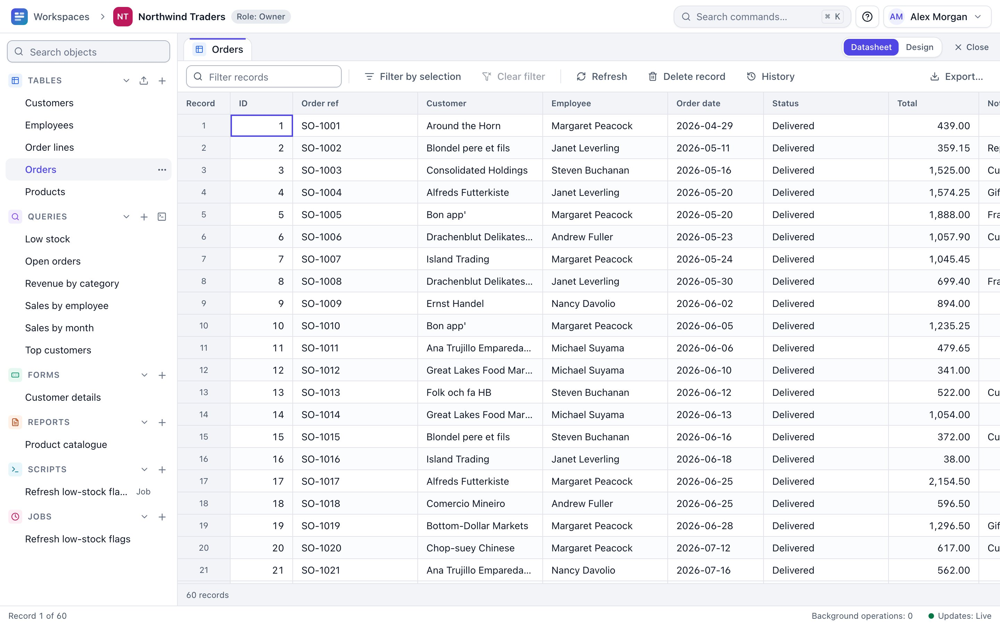

[Features](#features) | [Quick start](#quick-start) | [Choosing a database](#choosing-a-database) | [API](#using-the-api) | [Architecture](#architecture) | [Security](#security) | [Versioning](#versioning-and-releases) | [Development](#development) | [Documentation](#documentation) | [License](#license)

[](https://github.com/AbishYoung/AbiData/actions/workflows/ci.yml)
[](https://github.com/AbishYoung/AbiData/releases)
[](go.mod)
[](web/package.json)
[](LICENSE)

---

## Highlights

- **Zero-Dependency Deployment:** One self-contained binary packaging both backend and web application. Deploy in seconds with Docker Compose or as a standalone server.
- **Dual Database Backends:** Isolated single-file SQLite databases for zero-maintenance simplicity, or enterprise PostgreSQL schemas for centralized database infrastructure.
- **Relational Modeling & Audit Trail:** Typed columns, foreign key lookups, calculated expressions, validation rules, and per-record edit history with non-destructive merge conflict resolution.
- **Visual & SQL Query Engines:** Drag-and-drop query designer for non-technical users alongside a sandboxed read-only SQL editor with strict execution budgets and tabular exports.
- **Drag-and-Drop Forms & Banded PDF Reports:** Visual canvas form builder with subforms and event hooks, plus banded report generation (tabular and columnar) with server-side PDF output.
- **Geospatial & Mobile Camera:** Native GeoJSON `Location` (points) and `Area` (polygons with holes) field types with interactive maps and GPS capture, plus photo attachment buckets.
- **Sandboxed Lua 5.1 Automation:** Secure scripting environment with memory and CPU bounds, dialect-neutral `db.from()` query builder, `stats` & `data` analytical toolkits, cron scheduler, and strict egress gateway.
- **Zero-Account Public Apps:** Bundle forms and reports into standalone public web apps behind unguessable tokens for surveys, customer orders, or public reporting.
- **Static User Blogs:** Built-in Markdown authoring, split live preview, cover images, and static HTML publication at `/b/{username}` with Atom feeds.
- **Team Collaboration & Messaging:** Granular workspace roles (`owner`, `builder`, `editor`, `viewer`), candidate member directory, and built-in direct and workspace threaded messaging.

---

## Features

AbiData includes two separate, production-grade sample workspaces demonstrating the platform's capabilities:

- **Northwind Traders**: Comprehensive inventory, commercial order-processing, employee directory, supplier records, visual queries, forms, columnar reports, and automated low-stock monitoring jobs.
- **Biosecurity Watch**: Standalone regional biosecurity program featuring mobile field sightings, GPS positions, photo galleries, map polygon quarantine zones with interior holes, spatial queries, and banded maps reports.

Both sample workspaces are provisioned automatically for the first administrator upon completing setup. Administrators can also grant users copies of either sample from the admin console's **Workspaces** tab or via CLI with `abidata demo --owner you@example.com --kind traders` (or `--kind invasives`). See the [Installation Guide](docs/content/operations/install.md).

---

### Data & Table Design

- **Keyboard-Driven Datasheet:** Rapid record entry with spreadsheet-like navigation, multi-column sorting, selection-based filtering, inline search, and batch import/export.
- **Interactive Schema Designer:** Configure typed fields (text, number, currency, date, boolean, attachments, geo point/polygon), primary keys, required rules, default values, and index definitions with safe schema migration previews before applying changes.
- **Relational Lookups:** Establish foreign key relationships between tables with search-ahead picker controls.
- **Record History & Merge Conflict Resolution:** View complete timeline logs of who modified which fields and when. Never silently overwrite concurrent edits — resolve discrepancies field by field through an intuitive merge dialog.
- **Context Menus:** Right-click anywhere in the grid for instant filtering, sorting, record history inspection, and row management.

| | |
|---|---|
| 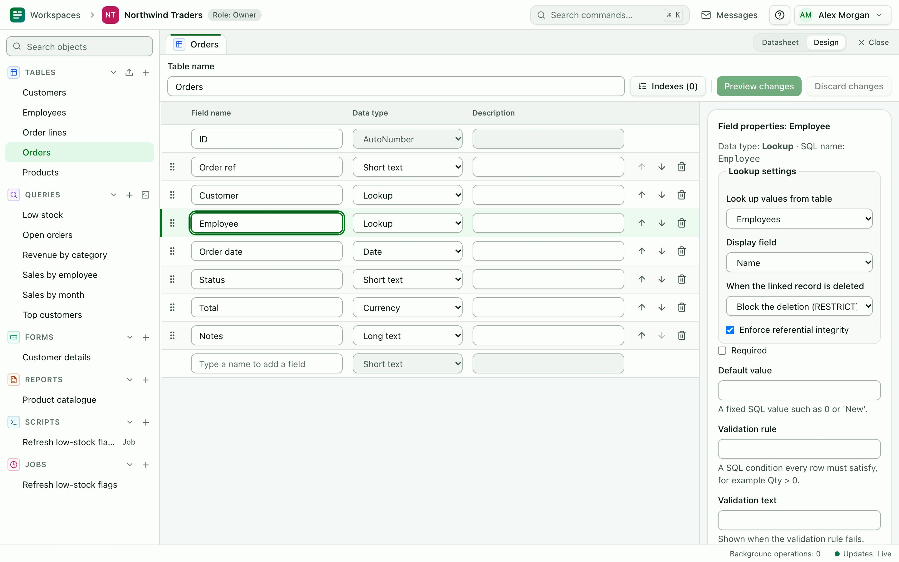 | 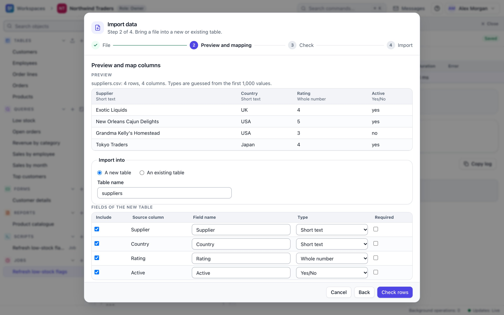 |
| *Visual table designer with field types, lookups, and schema migration preview* | *Import CSV, Excel (.xlsx), or JSON files directly into new or existing tables* |

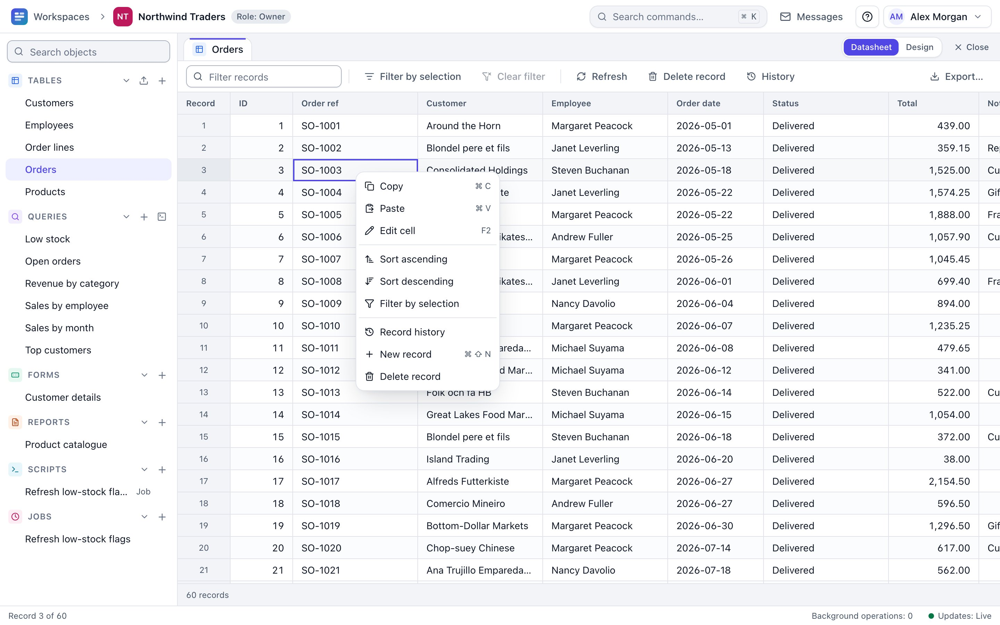
*Comprehensive cell and header context menus across datasheets, navigation tabs, and query results*

---

### Queries & Data Analysis

- **Visual Query Designer:** Non-technical builders construct multi-table joins, select output fields, specify grouping and aggregate functions, define filter parameters, and configure sort orders visually.
- **Sandboxed SQL Editor:** Direct read-only SQL queries executed with hard execution timeouts and row bounds to protect database performance.
- **Export & Integration:** Copy individual cells, selected rows, or entire result sets with tab-separated headers, or query results programmatically through the REST API.

| | |
|---|---|
| 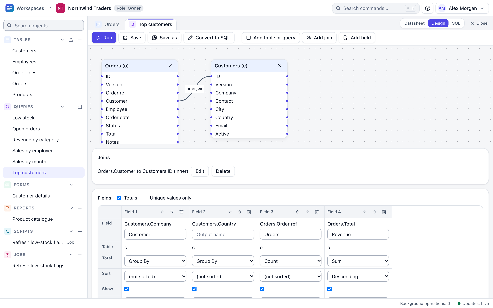 | 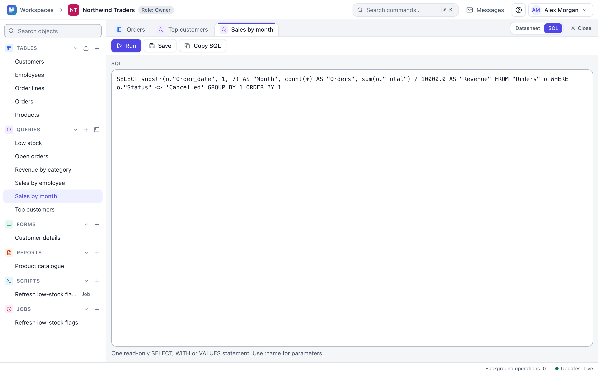 |
| *Visual join and criteria designer feeding forms and reports* | *Read-only SQL editor with syntax highlighting and parameter bindings* |

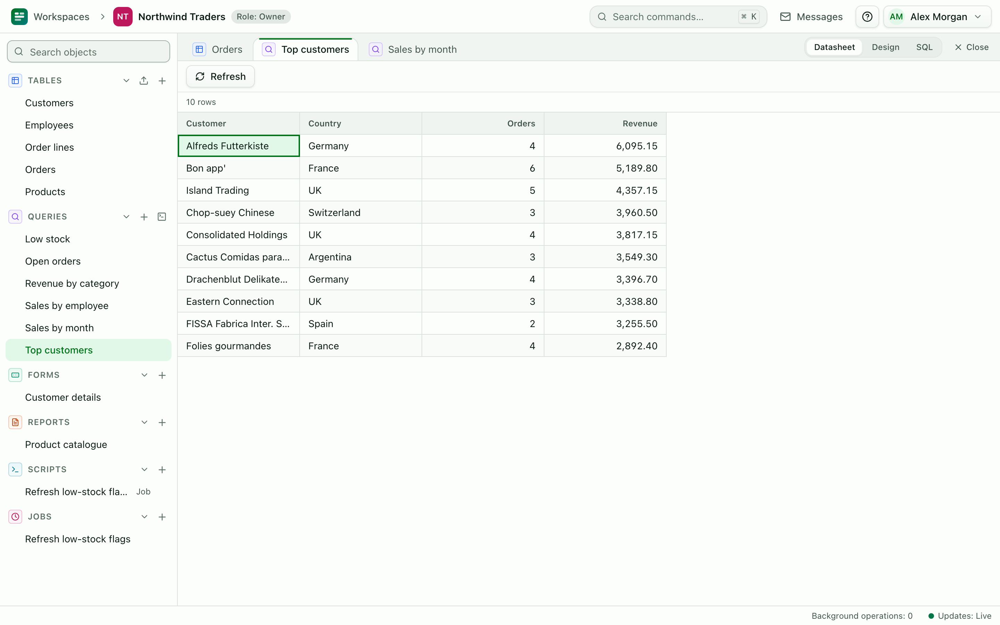
*Tabular query results with instantaneous sorting, copy-as-tsv, and execution metrics*

---

### Custom Forms & Banded PDF Reports

- **Form Canvas Designer:** Design bespoke data entry screens with text boxes, checkboxes, date pickers, dropdown lookups, subforms, calculated labels, and Lua event handlers (`on_load`, `on_change`, `before_save`, `after_save`).
- **Banded Report Generator:** Produce print-ready reports with configurable headers, group band headers/footers, summary totals, detail bands, and page footers.
- **Starter Layouts:** Launch new reports from **Tabular** (dense tabular listings) or **Columnar** (multi-column record blocks) templates with auto-wrapping text bands and server-side PDF generation.

| | |
|---|---|
| 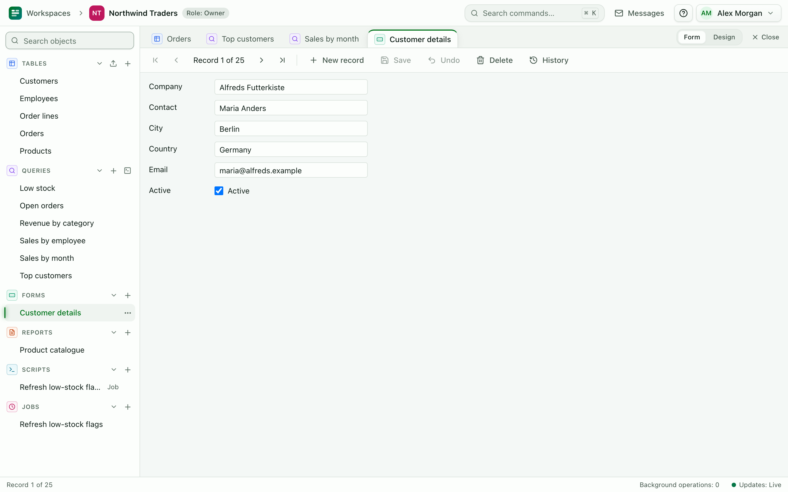 | 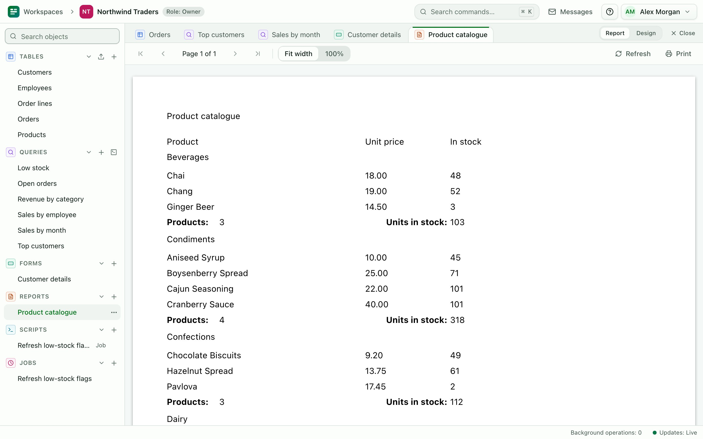 |
| *Interactive customer details form with subform order lines and validation* | *Banded product catalogue report with category grouping and totals* |

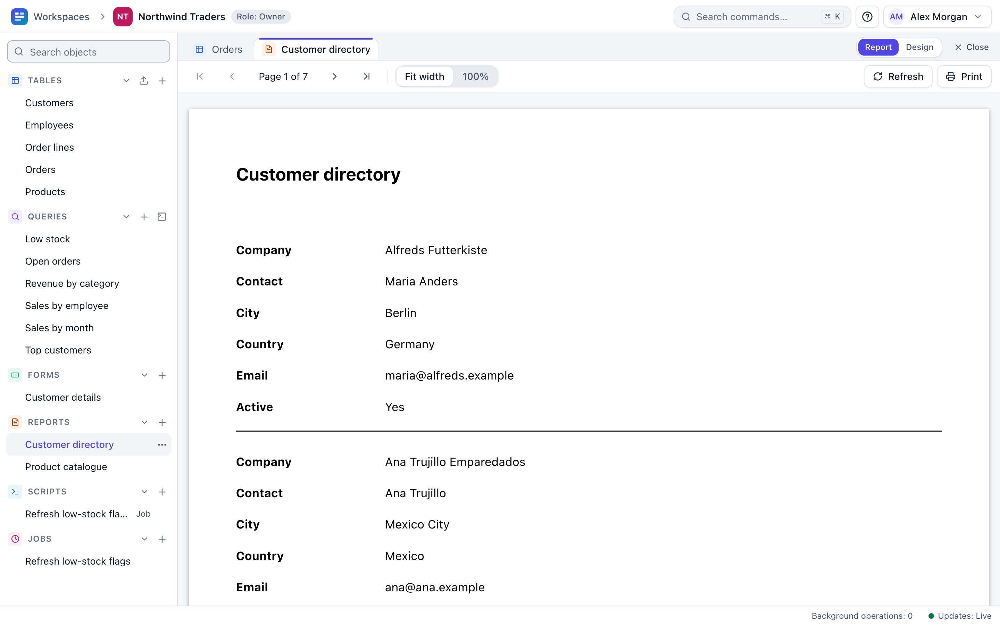
*Multi-column customer directory report generated from the Columnar starter layout*

---

### Geospatial Mapping & File Attachments

- **Location & Area GeoJSON Fields:** Store GPS coordinates (`Location`) and complex polygonal fences (`Area`), including multi-polygons with interior cutout holes.
- **Interactive Map Controls:** Visual map controls embedded in forms and reports display points, bounding boxes, and read-only polygon overlay layers. On mobile devices, **Use my location** captures coordinates with accuracy radiuses.
- **Spatial Queries & Distance Calculation:** Perform spatial joins of points within polygonal fences, leverage SQL helper functions (`geo_distance_m`, `geo_within`, `geo_area_m2`), or query through API bounding filters (`within`, `near`).
- **File & Photo Attachments:** Dedicated per-workspace attachment buckets with image thumbnailing, drag-and-drop uploads, mobile **Take photo** capture, and automated inclusion in workspace backups.

| | |
|---|---|
| 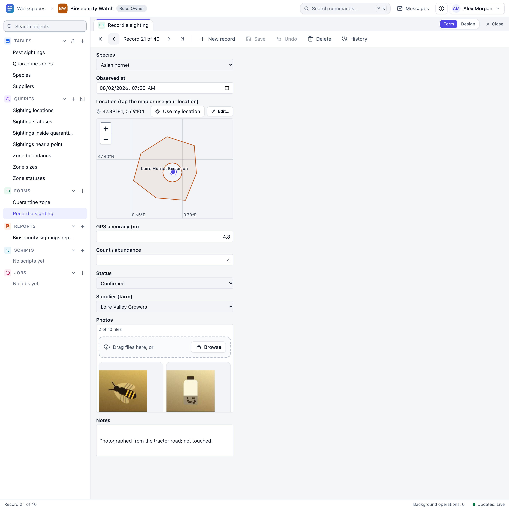 | 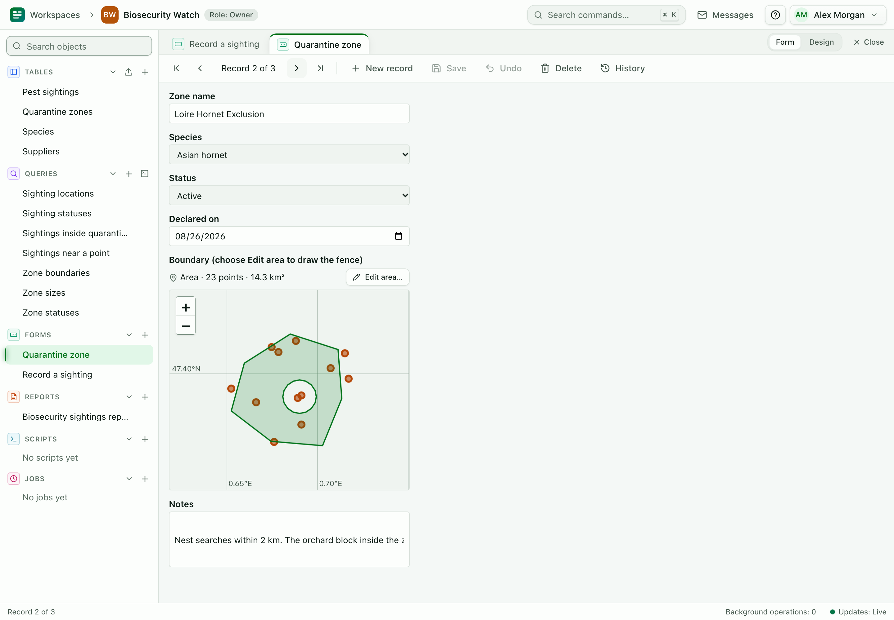 |
| *Field sighting form with interactive GPS map picker, quarantine overlay, and photo gallery* | *Quarantine zone boundary editor rendering polygon fences with interior treated zones* |

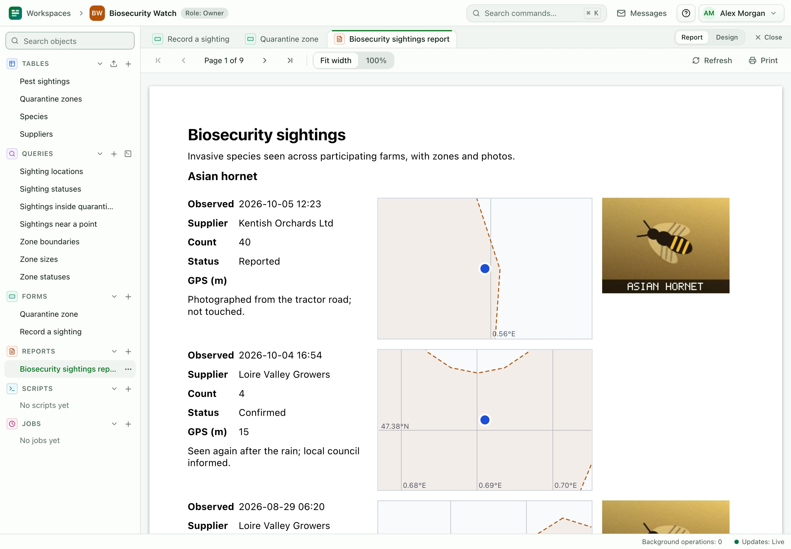
*Printable biosecurity field report combining vector map boundaries with high-resolution sighting photos*

---

### Safe Lua 5.1 Automation & Scheduled Jobs

- **Sandboxed Scripting:** Embedded Lua 5.1 runtime executing with bounded memory limits, instruction budgets, and context timeouts. No ambient filesystem, process, or raw socket access.
- **Dialect-Neutral Query Builder (`db.from`):** Construct safe database queries across SQLite and PostgreSQL without manual SQL formatting:
  ```lua
  local low_stock = db.from("Products")
    :where("Discontinued", false)
    :where_raw("In_stock <= Reorder_level")
    :order_by("In_stock", "asc")
    :all()
  ```
- **Data Science & Analytics Modules:** Built-in statistical analysis with `stats` (summary stats, median, variance, linear regression, moving averages) and dataset manipulation with `data` (grouping, aggregation, pivoting):
  ```lua
  local summary = stats.summary(orders, "Total")
  log.info("order statistics", { median = summary.median, mean = summary.mean })

  local pivot = data.pivot(orders, { row = "Customer", col = "Status", value = "Total", agg = "sum" })
  ```
- **Scheduled Background Jobs:** Execute Lua scripts via standard cron schedules with timezone support, overlap prevention, automatic retries, execution logs, and downloadable file artifacts.
- **Strict Egress Firewall:** Outbound HTTP requests (`fetch`) run only within scheduled jobs and route strictly through an administrative egress proxy restricted to explicit hostname allowlists.

| | |
|---|---|
| 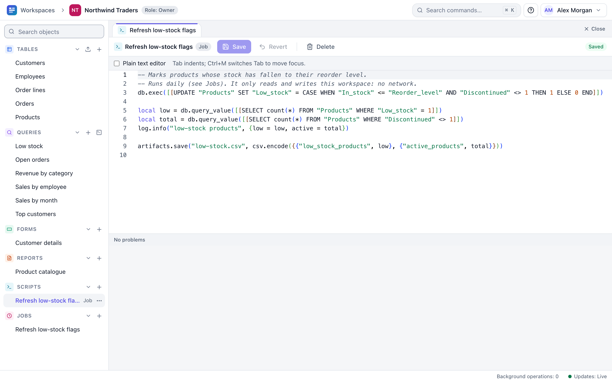 | 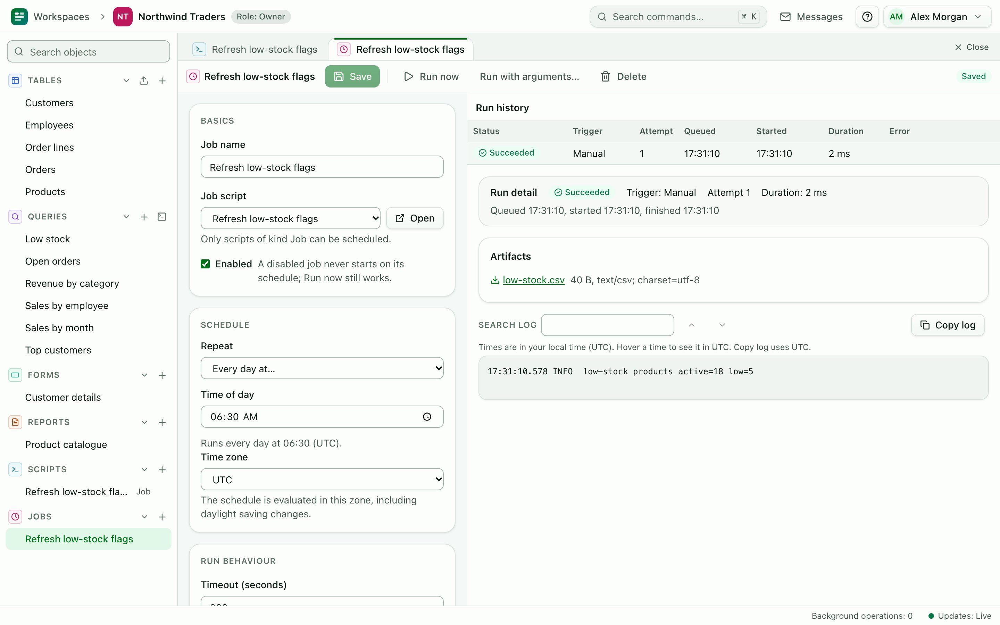 |
| *Script Studio with live diagnostics, autocompletion, and API reference* | *Automated job execution timeline with logs, metrics, and generated artifacts* |

---

### Public Web Apps & Static User Blogs

- **Zero-Account Public Apps:** Workspace owners can package select forms and reports into a branded web app accessible via an unguessable token link (`/a/{token}`). Visitors require no user accounts: forms allow record submission only, and reports remain strictly read-only.
- **Instant Takedown & Versioning:** Modifying published forms or reports automatically suspends public access until republished. Owners and platform administrators can revoke tokens or take down apps with one click.
- **Static User Blogs:** Every account includes an isolated personal blog workspace (`/b/{username}`) featuring a distraction-free Markdown editor, split live preview, cover image upload, and static HTML generation.
- **Syndication & Custom Domains:** Blogs generate standard Atom feeds (`/b/{username}/feed.xml`) and can be isolated on dedicated hostnames via `ABIDATA_BLOG_HOST`.

| | |
|---|---|
| 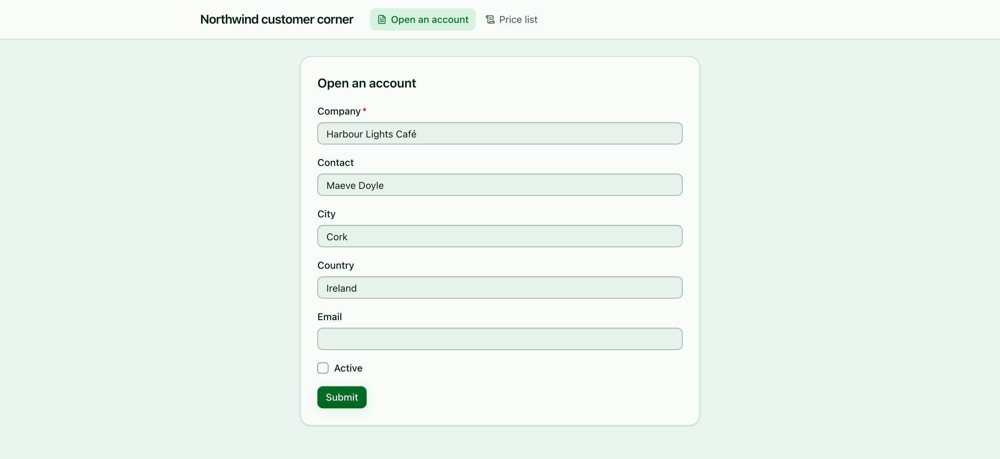 | 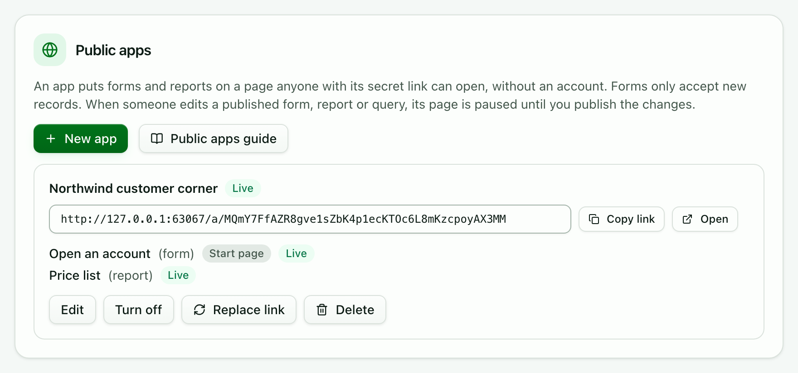 |
| *Public form accessible via secret link for external customer onboarding* | *Workspace app settings for configuring public routes, menus, and token access* |

| | |
|---|---|
| 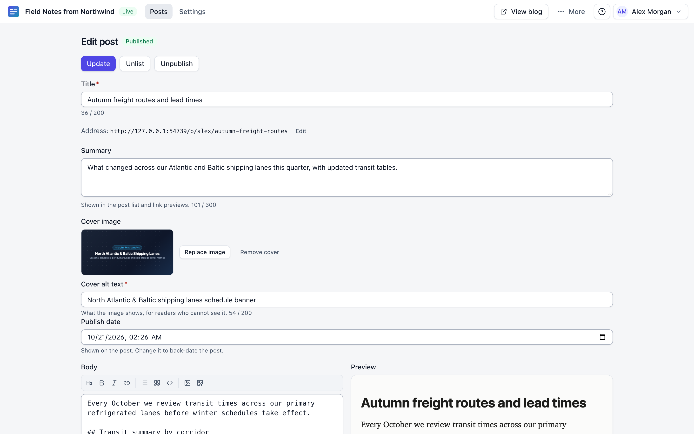 | 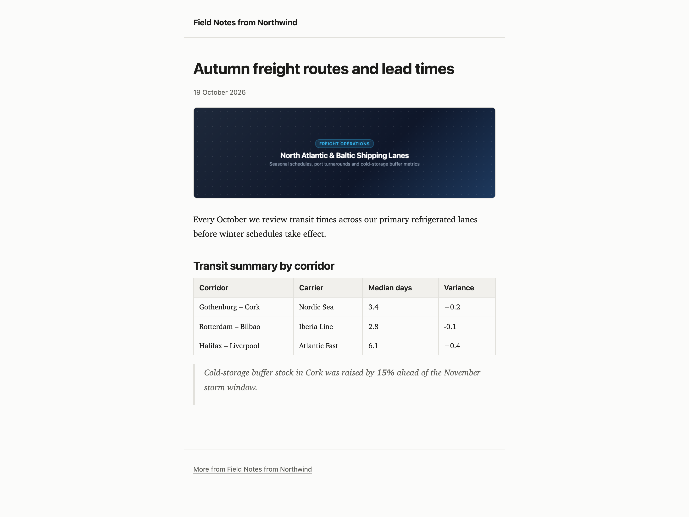 |
| *User blog editor with live preview, cover image management, and metadata controls* | *Server-rendered public blog post served as clean, accessible static HTML* |

---

### Team Collaboration & Internal Messaging

- **Role-Based Access Control (RBAC):** Assign permissions per workspace: **Viewer** (read-only), **Editor** (record CRUD), **Builder** (table, form, query, report, and script design), and **Owner** (full control over members, settings, backups, and API keys).
- **Candidate User Directory:** Workspace owners invite existing system users via a searchable directory picker or direct email address matching.
- **Internal Messaging (`/messages`):** Communicate without external tools. Start direct user-to-user messages or workspace-wide discussion threads with email-style hierarchical replies, search, unread badges, and archive controls.
- **Live Collaborative Sync:** Live updates propagate to active user datasheets via Server-Sent Events (SSE).

| | |
|---|---|
| 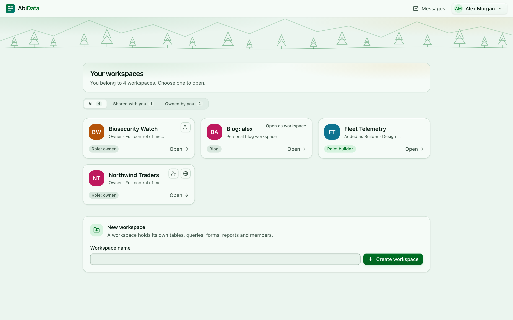 | 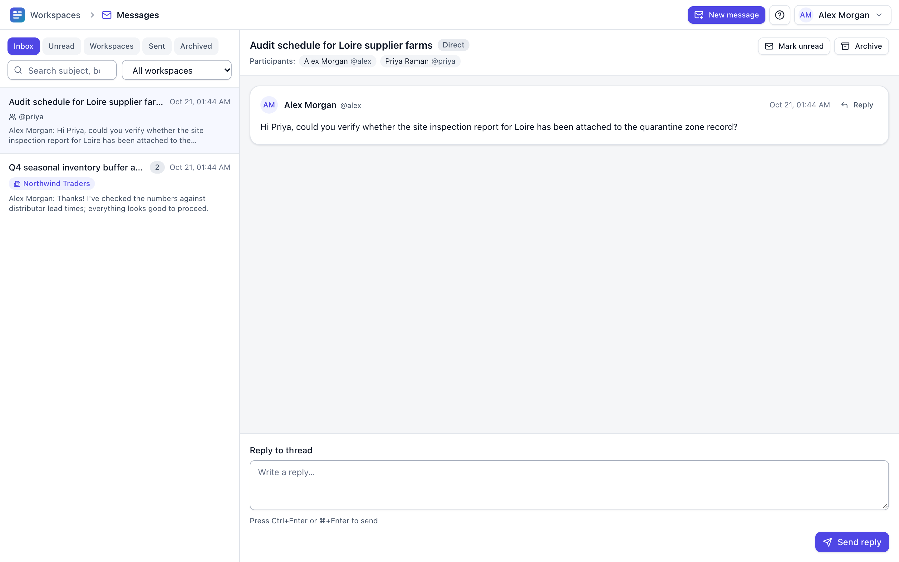 |
| *Workspace selector featuring role badges, filter tabs, and published app links* | *Two-pane internal messaging inbox supporting direct and workspace threaded conversations* |

| | |
|---|---|
| 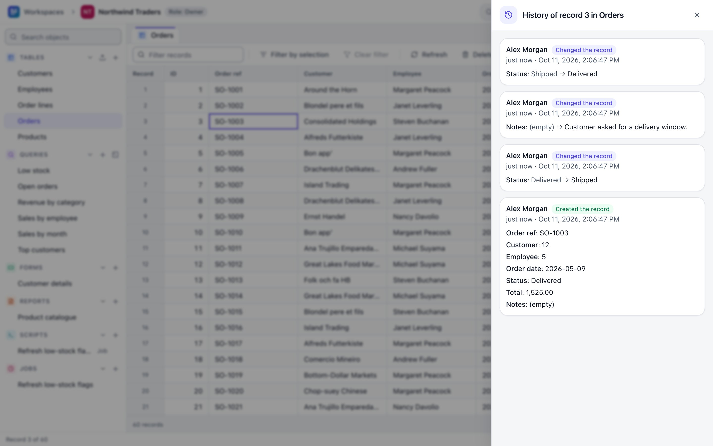 | 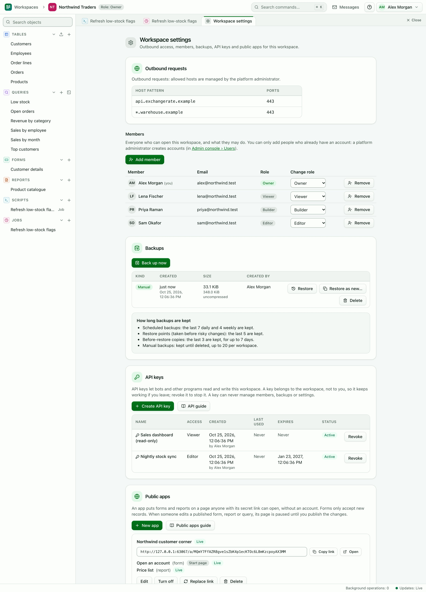 |
| *Per-record change history detailing timestamp, editor, and before/after values* | *Workspace settings: members management, backups, API keys, and public apps* |

---

### Production Operations & Observability

- **Centralized Admin Dashboard:** Real-time metrics tracking HTTP request volume, latency percentiles, memory consumption, active job executions, outbound egress requests, and storage allocation.
- **Verifiable Signed Backups:** Manual, automated cron, and pre-migration restore points. Backups are checksummed, LZ4 compressed, and HMAC signed. Restore in place or spin up as a new workspace.
- **Audit Logging:** Tamper-evident logging of authentication events, user role adjustments, workspace provisioning, app publication, and data exports.
- **Monitoring & Health Checks:** Native Prometheus metrics endpoint at `/metrics`, JSON structured logging, and container health probes at `/healthz` and `/readyz`.

| | |
|---|---|
| 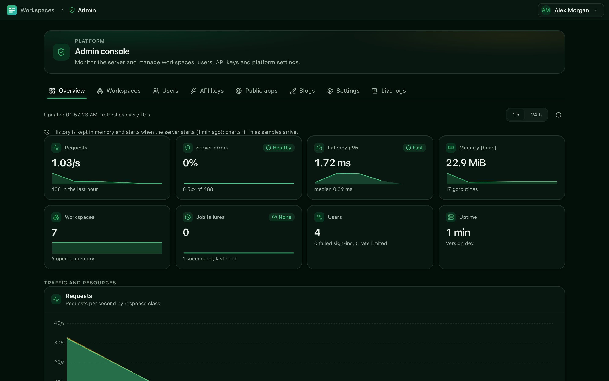 |  |
| *Administrative console: live telemetry, storage consumption, and audit trails* | *Complete system dashboard with dark theme contrast optimization* |

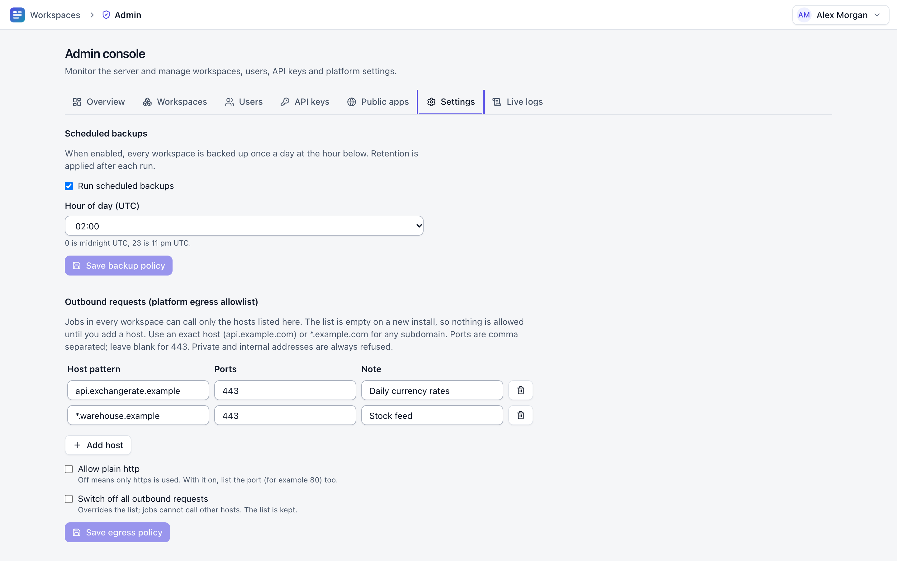
*Global platform administration: backup retention schedules and outbound egress allowlist*

---

### Mobile PWA & Accessibility

- **Progressive Web App (PWA):** Installable on iOS, Android, macOS, and Windows. On mobile viewports, tables adapt into responsive record cards, editors expand into full-screen sheets, and navigation nests in a drawer.
- **Comprehensive Keyboard Ergonomics:** Rapid navigation via the universal command palette (`Mod+K`), contextual documentation (`?`), and keyboard-driven datasheet controls (`Shift+F10` for context menus).
- **Automated Accessibility Testing:** Engineered to meet WCAG 2.1 AA standards. Automated axe core scanning runs across every surface in both light and dark themes on every build.

| | | |
|---|---|---|
| 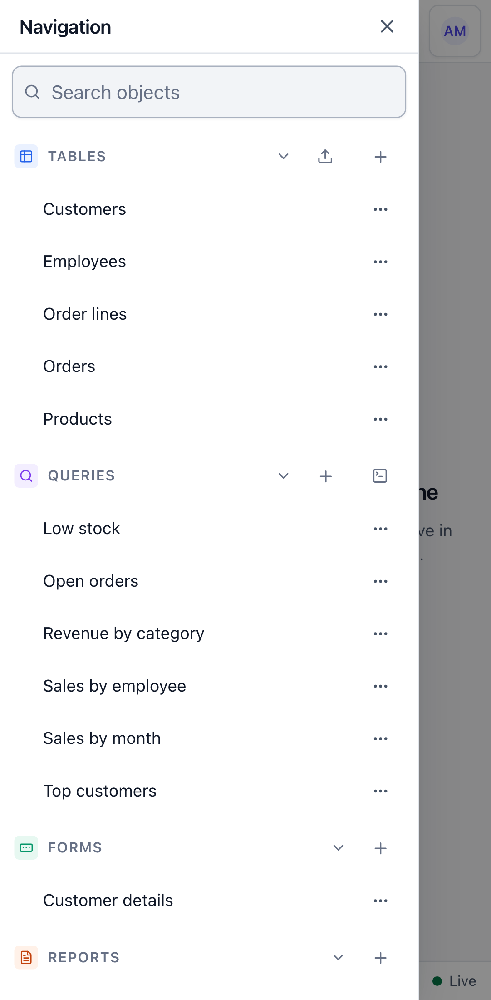 | 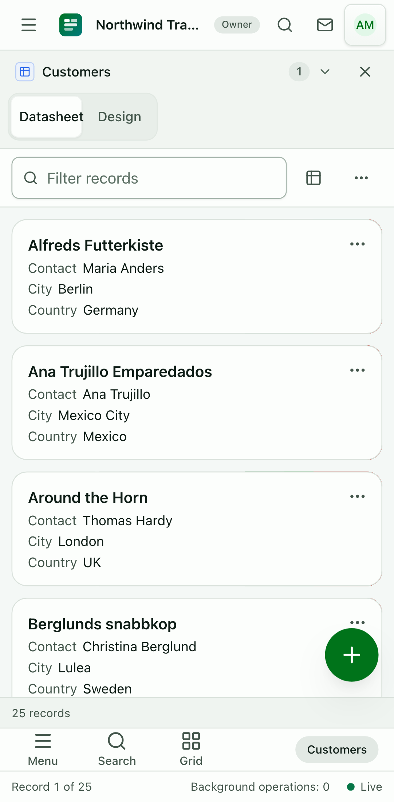 | 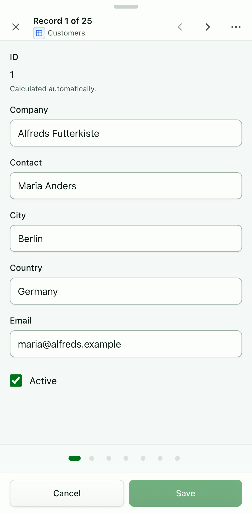 |
| *Mobile navigation drawer* | *Responsive touch cards* | *Full-screen mobile record editor* |

| | |
|---|---|
| 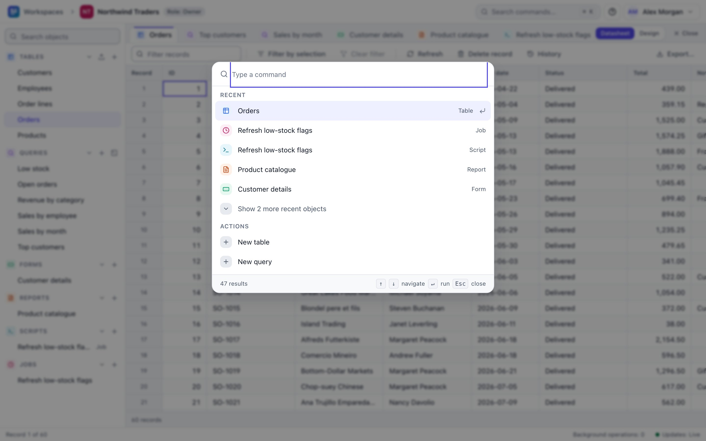 | 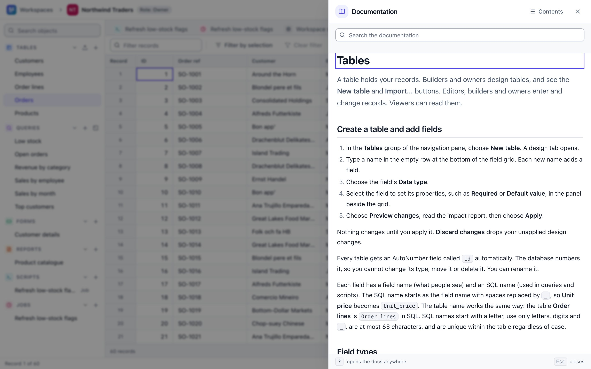 |
| *Universal command palette (`Mod+K`)* | *Integrated contextual documentation drawer (`?`)* |

| | |
|---|---|
| 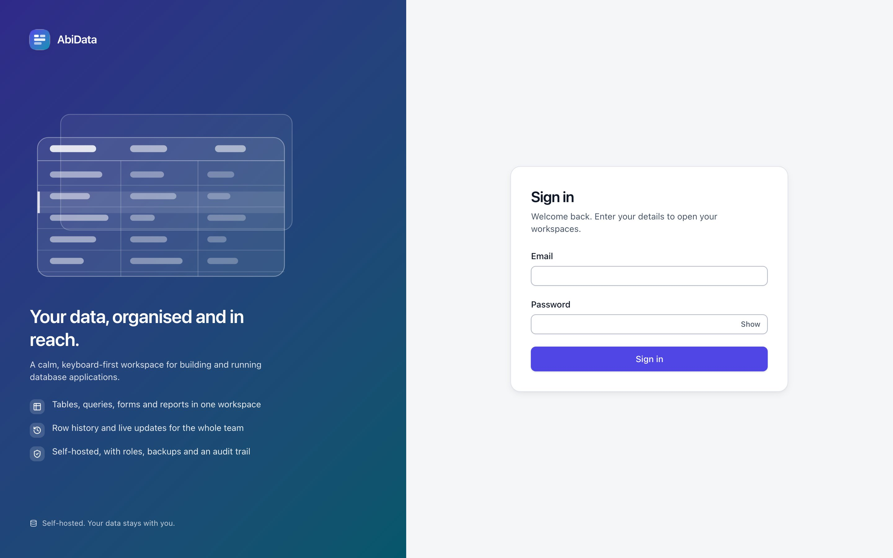 | 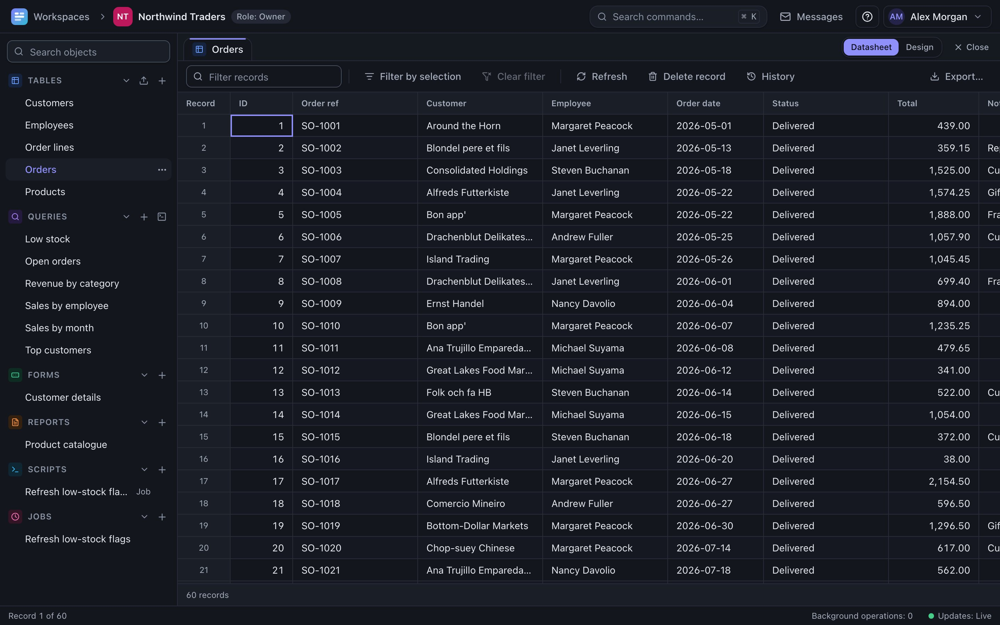 |
| *Clean sign-in interface with session rate limiting* | *High-contrast dark theme datasheet view* |

---

## Quick Start

### Option A: With Docker Compose (Recommended)

Requires Docker with the Compose v2 plugin.

#### 1. Development Evaluation
Run a standalone local instance on `http://localhost:8080`:

```sh
scripts/docker-dev.sh
```

Inspect the container logs to obtain the one-time initial setup token:
```sh
docker compose -p abidata-dev -f compose.yaml -f compose.dev.yaml logs abidata | grep setup_token
```
Open `http://localhost:8080`, submit the setup token, and create your platform administrator account.

#### 2. Production Deployment (Automatic HTTPS via Caddy)
Launch a production-hardened instance with automatic TLS termination:

```sh
export ABIDATA_PUBLIC_URL=https://abidata.example.com
export ABIDATA_SITE=abidata.example.com
export ABIDATA_BOOTSTRAP_ADMIN_EMAIL=admin@example.com

scripts/docker-prod.sh
```

---

### Option B: Build From Source

Requires **Go 1.24+** and **Node.js 24+** (LTS).

```sh
# Clone repository
git clone https://github.com/AbishYoung/AbiData.git
cd AbiData

# Install frontend dependencies and launch local development
make dev
```

To compile a single static production binary containing the embedded frontend:

```sh
make build
# Produces bin/abidata
./bin/abidata serve
```

---

## Choosing a Database

AbiData features a decoupled, backend-agnostic SQL storage architecture ([ADR 0013](docs/adr/0013-backend-agnostic-sql-layer.md)) supporting both SQLite and PostgreSQL.

### SQLite (Default)
- **Zero Configuration:** Workspaces exist as independent SQLite databases in your storage directory.
- **Total Isolation:** Corrupting or locking one workspace can never impact another workspace.
- **Portability:** Backing up or copying a workspace is as simple as copying a single `.db` file.
- **Ideal For:** Small-to-medium teams, edge deployments, and straightforward single-server configurations.

### PostgreSQL Backend
- **Centralized Infrastructure:** Manage all workspaces within a managed PostgreSQL cluster (AWS RDS, GCP Cloud SQL, Supabase, self-hosted).
- **Schema-Per-Workspace Isolation:** Each workspace operates within its own dedicated PostgreSQL schema, backed by transactional isolation and role boundaries.
- **Portable Archives:** Workspaces can be exported into standard signed SQLite archive packages and imported seamlessly into PostgreSQL installations.
- **Configuration:** Set `ABIDATA_DB=postgres` and provide connection parameters (`ABIDATA_PG_HOST`, `ABIDATA_PG_PORT`, `ABIDATA_PG_DATABASE`, `ABIDATA_PG_USER`, `ABIDATA_PG_PASSWORD`). See [PostgreSQL Backend Specification](docs/adr/0012-postgres-backend.md) and [Configuration Guide](docs/content/operations/configuration.md).

---

## Using the API

Every feature in the web application is powered by an OpenAPI 3.1 REST API. Workspace owners can generate scoped **API keys** (`viewer`, `editor`, `builder`) with optional expiration timestamps:

```sh
export ABIDATA=https://abidata.example.com
export WS="01JEXAMPL00000000000000000"
export KEY="abd_live_examplekey123"

# Inspect workspace schema
curl -sS -H "Authorization: Bearer $KEY" "$ABIDATA/api/v1/w/$WS/schema"

# Query rows with filtering and sorting
curl -sS -H "Authorization: Bearer $KEY" \
  "$ABIDATA/api/v1/w/$WS/tables/<table_id>/rows?limit=10&sort=-<field_id>"

# Insert record with idempotency protection
curl -sS -X POST "$ABIDATA/api/v1/w/$WS/tables/<table_id>/rows" \
  -H "Authorization: Bearer $KEY" \
  -H "Content-Type: application/json" \
  -H "Idempotency-Key: $(uuidgen)" \
  -d '{"fields": {"<field_id>": "Value"}}'
```

Mutating operations enforce concurrency validation via `If-Match` version headers. Explore the complete interactive OpenAPI schema served directly at `/api/v1/openapi.json`. Refer to the [API Access Guide](docs/content/guide/api.md) for detailed examples.

---

## Architecture

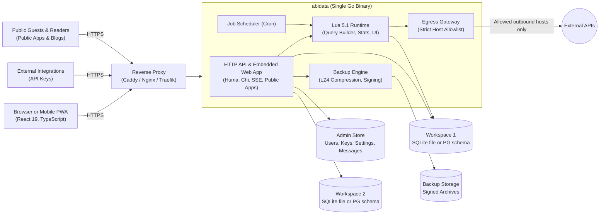

Key Architectural Principles:
1. **Single Binary Simplicity:** Backend services, static web assets, and migration scripts compile into a single static executable.
2. **Strict Multi-Tenancy:** Each workspace maintains its own database engine connection, statement cache, and schema catalog.
3. **Defense-in-Depth Scripting:** Sandboxed Lua execution prevents filesystem traversal, environment inspection, or arbitrary network access.
4. **Architectural Decision Records (ADRs):** Comprehensive technical rationales are maintained in [docs/adr](docs/adr):
   - [ADR 0001: SQLite Driver](docs/adr/0001-sqlite-driver.md)
   - [ADR 0002: Lua Sandbox Spike](docs/adr/0002-lua-sandbox-spike.md)
   - [ADR 0003: Huma on Chi](docs/adr/0003-huma-chi.md)
   - [ADR 0004: Gopher-Lua Fork](docs/adr/0004-gopher-lua-fork.md)
   - [ADR 0005: Form Save Endpoints](docs/adr/0005-form-save-endpoints.md)
   - [ADR 0007: Restore As New](docs/adr/0007-restore-as-new-for-owners.md)
   - [ADR 0008: Global Egress Allowlist](docs/adr/0008-global-egress-allowlist.md)
   - [ADR 0009: Workspace API Keys](docs/adr/0009-workspace-api-keys.md)
   - [ADR 0010: Geo Fields](docs/adr/0010-geo-fields.md)
   - [ADR 0011: File Attachments](docs/adr/0011-file-attachments.md)
   - [ADR 0012: PostgreSQL Backend](docs/adr/0012-postgres-backend.md)
   - [ADR 0013: Backend-Agnostic SQL Layer](docs/adr/0013-backend-agnostic-sql-layer.md)
   - [ADR 0014: Public Apps](docs/adr/0014-public-apps.md)
   - [ADR 0015: Web UI Modernisation](docs/adr/0015-web-ui-review-and-modernisation.md)
   - [ADR 0016: Layered Testing](docs/adr/0016-layered-testing.md)
   - [ADR 0017: User Blogs](docs/adr/0017-user-blogs.md)

---

## Security

AbiData employs robust security primitives across every layer:
- **Authentication:** Passwords hashed with adaptive **Argon2id** memory parameters. Session cookies are `HttpOnly`, `SameSite=Lax`, and `Secure`.
- **Brute-Force Protection:** Intelligent exponential backoff and rate limiting across login and sensitive endpoints.
- **CSRF & Origin Verification:** All state-modifying requests require anti-CSRF token verification and matching `Origin` headers.
- **Query Sandboxing:** User SQL queries run through a restrictive database authorizer prohibiting DDL execution, filesystem functions, or system tables.
- **Outbound Network Isolation:** Scheduled scripts reach the network only through an egress gateway that rejects private RFC 1918 addresses and demands explicit domain whitelisting.
- **Backup Verification:** Workspace backup archives are compressed, tamper-checked, and authenticated using HMAC keys.

For complete threat models and production checklists, read the [Operations Security Guide](docs/content/operations/security.md).

---

## Versioning and Releases

AbiData strictly adheres to [Semantic Versioning (SemVer 2.0.0)](https://semver.org/):
- **Major releases (`X.0.0`)**: Incompatible changes to the REST API, breaking Lua host API modifications, or database schema changes requiring manual migration.
- **Minor releases (`1.X.0`)**: Backward-compatible new features, added UI capabilities, additive API endpoints, and safe automatic migrations.
- **Patch releases (`1.0.X`)**: Backward-compatible bug fixes and security updates.

Consult [CHANGELOG.md](CHANGELOG.md) for detailed version history and [RELEASING.md](RELEASING.md) for the release checklist and procedure.

---

## Development

### Repository Layout

| Directory | Purpose |
|---|---|
| `cmd/abidata` | Server entry point: `serve`, `user`, `demo`, `healthcheck`, `version` |
| `internal/` | Core backend packages: `httpapi`, `auth`, `admin`, `workspace`, `catalog`, `records`, `query`, `forms`, `reports`, `apps`, `blogs`, `script`, `jobs`, `egress`, `backup`, `sqlgen`, `dbx` |
| `web/` | React 19 frontend application (Vite, TypeScript, Tailwind CSS, TanStack Router) |
| `tests/e2e/` | Playwright end-to-end integration test suite with axe accessibility validation |
| `docs/content/` | In-app documentation and operator guides; `docs/images/` holds UI screenshots |
| `scripts/` | Tooling for Docker setups, secret generation, and the screenshot pipeline |
| `tools/` | Code generators (`tools/gen`) and intelligent test planning (`tools/testplan`) |

### Common Make Targets

| Command | Action |
|---|---|
| `make dev` | Start local backend server with built frontend assets |
| `make dev-web` | Start Vite development server with hot-module reloading |
| `make build` | Compile optimized static binary into `bin/abidata` |
| `make lint` | Run `golangci-lint`, frontend type checking, and ESLint |
| `make test` | Run Go unit/integration test suites and frontend Vitest suite |
| `make test-changed` | Execute only the tests affected by changes on your current branch |
| `make test-postgres` | Run PostgreSQL integration test suites against throwaway Docker containers |
| `make e2e` | Run complete Playwright end-to-end browser test suite |
| `make screenshots` | Automatically rebuild and capture all UI screenshots in `docs/images/` |

---

## Documentation

Full documentation is embedded directly inside every AbiData installation — press `?` or click the documentation button in the top navigation bar.

- **Getting Started:** [Welcome & Overview](docs/content/guide/index.md)
- **User Guide:** [Tables](docs/content/guide/tables.md), [Queries](docs/content/guide/queries.md), [Forms](docs/content/guide/forms.md), [Reports](docs/content/guide/reports.md), [Public Web Apps](docs/content/guide/apps.md), [User Blogs](docs/content/guide/blogs.md), [Lua Scripts](docs/content/guide/scripts.md), [Scheduled Jobs](docs/content/guide/jobs.md), [Internal Messaging](docs/content/guide/messages.md), [Data Imports & Exports](docs/content/guide/imports-exports.md), [Backups](docs/content/guide/backups.md), [API Access](docs/content/guide/api.md), [Members & Roles](docs/content/guide/members-and-roles.md), [Keyboard Shortcuts](docs/content/reference/shortcuts.md), [Biosecurity Sample Walkthrough](docs/content/guide/example-invasive-species.md)
- **Operations Guide:** [Installation](docs/content/operations/install.md), [Configuration Reference](docs/content/operations/configuration.md), [Security Architecture](docs/content/operations/security.md), [System Monitoring](docs/content/operations/monitoring.md), [Backup Strategy](docs/content/operations/backup-strategy.md), [Upgrade Guide](docs/content/operations/upgrade.md)

---

## License

AbiData is open-source software licensed under the [MIT License](LICENSE). Copyright &copy; 2026 AbishYoung.
