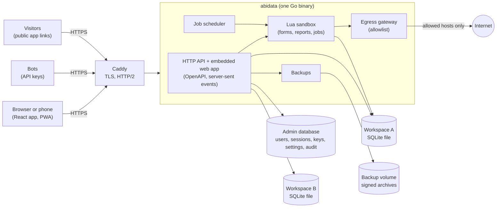

# AbiData

AbiData is a self-hosted database application platform for teams, in the spirit of Microsoft Access. Builders design **tables, queries, forms, reports, Lua scripts and scheduled jobs** in the browser. Everyone else works with them from a desktop or a phone, and owners can publish chosen forms and reports to people without an account. Each project lives in its own **workspace**, which is a single SQLite file on your server. The backend is one Go binary with the React web app embedded in it.


[Features](#features) | [Quick start](#quick-start) | [API](#using-the-api) | [Architecture](#architecture) | [Security](#security) | [Development](#development) | [Documentation](#documentation) | [License](#license)

[](LICENSE)

## Features

AbiData comes with two separate sample workspaces, and every screenshot below comes from them:

- **Northwind Traders**: employees, customers, products, orders, saved queries, a form, a report and a scheduled job.
- **Northwind Invasives**: supplier farms, invasive species sightings with GPS positions and photos, quarantine zones drawn as fences on a map, spatial queries and a report with maps.

Both are created for the first administrator when setup finishes. Later, an administrator can give every user a copy of either sample from the admin console's **Workspaces** tab, or add one for a single user with `abidata demo --owner you@example.com --kind traders` (or `--kind invasives`) while the server is stopped. See [Install](docs/content/operations/install.md).

### Data

- **Datasheet** editing of records in a keyboard-driven grid, with filter by selection, sorting, import and export.
- **Table design** with typed fields, required fields, defaults, validation, calculated fields and indexes. You preview the impact of a change before you apply it.
- **Lookups** between tables, so a field can point at a record in another table.
- **History**: each table can keep a per-record history of who changed what and when.
- **Context menus**: right-click a cell for copy, paste, sorting, filter by selection, record history, new record and delete. Column headings, navigation items, document tabs and query results have their own menus.

| | |
|---|---|
|  |  |
| Design fields and lookups, then preview and apply | Import CSV, Excel or JSON into a new or existing table |


### Maps, fences and attachments

- **Location and area fields** store a point or a fence (a polygon, with holes if you need them) as GeoJSON. Forms and reports have a **Map** control that draws the value and read-only overlays, such as quarantine zones. On a phone, **Use my location** records the position and its accuracy. Base map tiles are off by default, so nothing about your locations leaves your server unless an administrator sets a tile source.
- **Spatial queries**: a visual join of points to areas, SQL functions such as `geo_distance_m`, `geo_within` and `geo_area_m2`, and `within` and `near` filters in the API.
- **Attachments fields** hold photos and documents in a per-workspace file bucket that is included in backups. Forms show a gallery with **Take photo** on phones, and reports can print the first image.

The sample's [invasive species walkthrough](docs/content/guide/example-invasive-species.md) covers recording a sighting on a phone, drawing a zone, the queries, the report and the API calls.

| | |
|---|---|
|  |  |
| Record a sighting: zones on the map, accuracy and photos | A quarantine zone with a hole, and the sightings around it |


### Queries

Build queries visually (tables, joins, criteria, totals, parameters) or in SQL. SQL queries are read-only, and every query runs with time and row limits. Saved queries can feed forms and reports and can be run through the API. Right-click the results to copy a cell, a row or every row with headings as tab-separated text.

| | |
|---|---|
|  |  |
| Visual designer | A saved SQL query |


### Forms and reports

Forms are designed on a canvas, with Lua event handlers, calculated controls and subforms. Reports are banded, with grouping and totals, and can be printed or saved as PDF. A new report can start blank or from a **Tabular** layout (one row per record under headings) or a **Columnar** layout (one block per record, each field's name beside its value). Detail bands can grow, so long text wraps instead of being cut off.

| | |
|---|---|
|  |  |
| Customer details form | Product catalogue report |


### Public apps

Workspace owners can bundle forms and reports into an **app** and publish it behind a secret link. Visitors need no account and see only the app, never the rest of the workspace. Forms accept new records only, and reports are read-only. When someone edits a published form, report or query, its page is paused until an owner publishes the change. Owners can turn an app off or replace its link at any time. Platform administrators see every app in the admin console's **Public apps** tab, can take one down, and can turn the feature off for the server (or for good with `ABIDATA_PUBLIC_APPS=false`). See the [Public apps guide](docs/content/guide/apps.md).

| | |
|---|---|
|  |  |
| A public app's form, opened from its link without signing in | Publishing and managing apps in workspace settings |

### Automation

- **Lua scripts** (Lua 5.1) run in a server-side sandbox with time and memory limits. Script Studio checks your code as you type.
- **Scheduled jobs** run a script on a schedule with a time zone, overlap and misfire policies, retries, run history, logs and file artifacts.
- **Egress allowlist**: jobs can reach the internet only through a gateway, only to hosts a platform administrator has allowed. A fresh install allows none.

| | |
|---|---|
|  |  |
| Script Studio | A job with its run history, log and artifact |

### Collaboration

- **Roles** per workspace: viewer, editor, builder and owner.
- **Members** are added by owners from accounts that a platform administrator created. Nobody self-registers.
- **Live updates**: other people's changes appear in your datasheet as they happen.
- **Row history** shows every change to a record, newest first.
- **Conflict handling**: every record has a version, a save never silently overwrites someone else's edit, and a merge dialog lets you choose field by field.

| | |
|---|---|
|  |  |
| Row history | Workspace settings: members, backups, API keys and public apps |

### Operations

- **Admin dashboard** with live request, latency, memory, job and outbound-request charts, plus workspace storage, backup status and the latest audit events. History is kept in memory since the last server start.
- **Backups**: manual, scheduled and restore-point backups of each workspace. They are checked for corruption, compressed and signed. Owners can restore in place or restore as a new workspace.
- **Audit log** of administrative and security-relevant events.
- **Admin console** tabs for workspaces (including giving everyone a copy of a sample), users, API keys, public apps, platform settings and live logs.
- **Metrics** for Prometheus at `/metrics`, JSON logs, health checks at `/healthz` and `/readyz`, and a live log stream for administrators.

| | |
|---|---|
|  |  |
| Admin console, light | Admin console, dark |


### API

Everything the web app does goes through a JSON API. Workspace owners can create **API keys** (viewer, editor or builder access, optional expiry) for bots and integrations. The full API is described by an OpenAPI document served at `/api/v1/openapi.json`. See [Using the API](#using-the-api).

### Mobile

AbiData is an installable web app (a PWA). On a phone, tables show as record cards, a record opens in a full-screen sheet, and navigation moves into a drawer.

| | | |
|---|---|---|
|  |  |  |
| Drawer | Record cards | Record sheet |

### Accessibility and keyboard

The command palette (`Mod+K`) and the built-in documentation (`?`) are always one key away. Datasheets, forms and designers can be driven entirely from the keyboard (see the [shortcut reference](docs/content/reference/shortcuts.md)). `Shift+F10` or the context-menu key opens the same menu as a right-click. There is a light and a dark theme, and the end-to-end suite runs automated axe accessibility checks in both.

| | |
|---|---|
|  |  |
| Command palette | Documentation beside your work |


| | |
|---|---|
|  |  |
| Sign in | Workspace picker |

## Quick start

### With Docker

You need Docker with the Compose plugin.

**Try it on your machine** (the app alone on `http://localhost:8080`, debug logging, no TLS):

```sh
scripts/docker-dev.sh          # also: up --lan | down | logs | status
```

Set `ABIDATA_DEV_PORT` to use another port. `ABIDATA_DEV_RESET=1 scripts/docker-dev.sh down` also deletes the development data. The script uses the first-administrator email `admin@example.com` unless you set `ABIDATA_BOOTSTRAP_ADMIN_EMAIL`.

**Run it for real** (Caddy in front, automatic HTTPS):

```sh
export ABIDATA_PUBLIC_URL=https://abidata.example.com   # the exact address people type, no path
export ABIDATA_SITE=abidata.example.com                 # the host name Caddy serves
export ABIDATA_BOOTSTRAP_ADMIN_EMAIL=you@example.com
scripts/docker-prod.sh         # also: down | logs | status
```

The production script requires an `https` public URL, creates the secret files in `secrets/` if they are missing (or run `scripts/gen-secrets.sh` yourself), starts the stack, waits until the server is healthy and tells you whether setup is still pending. It binds ports 80 and 443. Without `ABIDATA_PUBLIC_URL` and `ABIDATA_SITE` the stack defaults to `https://localhost`.

**First run.** With `ABIDATA_BOOTSTRAP_ADMIN_EMAIL` set and no users yet, the server logs a one-time setup token at warning level:

```sh
docker compose logs abidata | grep setup_token
# for the development stack: docker compose -p abidata-dev -f compose.yaml -f compose.dev.yaml logs abidata | grep setup_token
```

Open the site, paste the token, choose a display name and a password of at least 10 characters. The account uses the configured email. When setup finishes, AbiData also creates the **Northwind Traders** and **Northwind Invasives** sample workspaces and makes you their owner. Set `ABIDATA_DEMO_WORKSPACE=false` before the first start to skip it.

Details, including the volumes, proxy settings and the command-line alternative for creating the first administrator, are in [Install](docs/content/operations/install.md). Every setting is in [Configuration](docs/content/operations/configuration.md).

### From source

You need Go (the version in [go.mod](go.mod)) and Node.js 24 with npm.

```sh
make dev
```

This builds the web app, then runs the server on `http://localhost:8080` with data in `.data/`. It sets `ABIDATA_BOOTSTRAP_ADMIN_EMAIL` to `admin@example.com` (override it with `make dev ABIDATA_BOOTSTRAP_ADMIN_EMAIL=you@example.com`). Take the setup token from the server's log output, as above.

To work on the web app with hot reload, run `make dev-web` in a second terminal. `make build` produces a static binary at `bin/abidata` with the web app embedded. Put a TLS-terminating proxy in front of it and make sure the proxy does not buffer `text/event-stream` responses (live updates use server-sent events).

## Using the API

Create a key in **Workspace settings, API keys** (owners only). The full key is shown once. Then send it as a bearer token:

```sh
export ABIDATA=https://abidata.example.com
export WS=<workspace id>            # the id in the address bar: /w/<workspace id>
export KEY=abd_...                  # your API key

# the workspace's tables and fields (ids, not display names, address rows)
curl -sS -H "Authorization: Bearer $KEY" "$ABIDATA/api/v1/w/$WS/schema"

# the first rows of a table, highest price first
curl -sS -H "Authorization: Bearer $KEY" \
  "$ABIDATA/api/v1/w/$WS/tables/<table id>/rows?limit=2&sort=-<field id>"
```

Writes need `Idempotency-Key` and, for updates and deletes, an `If-Match` version header, so two programs cannot overwrite each other. A key belongs to one workspace, can never be an owner, and cannot reach admin or sign-in routes. The [API access guide](docs/content/guide/api.md) has worked examples for inserts, updates, batches, saved queries, jobs and the event stream.

## Architecture



- One process serves the API and the embedded web app. Each workspace is one SQLite file, opened on demand. The admin database holds users, sessions, API keys, platform settings and the audit log.
- Services reach the databases through a driver-neutral layer (`internal/dbx`), and schema migrations live in `internal/admin/migrations/sqlite/` and `internal/catalog/migrations/sqlite/`.
- Scripts run in a Lua sandbox with no file, process or network access except through reviewed functions. Jobs are started by the scheduler or by hand, and only they can make outbound requests, through the egress gateway.
- Caddy terminates TLS in the provided Compose stack. The server trusts `X-Forwarded-For` only from the proxy addresses you configure.
- Decisions that shaped the design are recorded as ADRs in [docs/adr](docs/adr): [SQLite driver](docs/adr/0001-sqlite-driver.md), [Lua sandbox](docs/adr/0002-lua-sandbox-spike.md), [gopher-lua fork](docs/adr/0004-gopher-lua-fork.md), [huma on chi](docs/adr/0003-huma-chi.md), [form save endpoints](docs/adr/0005-form-save-endpoints.md), [restore as new](docs/adr/0007-restore-as-new-for-owners.md), [global egress allowlist](docs/adr/0008-global-egress-allowlist.md), [workspace API keys](docs/adr/0009-workspace-api-keys.md), [geo fields](docs/adr/0010-geo-fields.md), [file attachments](docs/adr/0011-file-attachments.md) and [public apps](docs/adr/0014-public-apps.md). The original implementation brief is [docs/BRIEF.md](docs/BRIEF.md) and progress notes are in [PROGRESS.md](PROGRESS.md).
- **Planned:** PostgreSQL as an alternative backend ([ADR 0012](docs/adr/0012-postgres-backend.md)), built on a backend-agnostic SQL layer ([ADR 0013](docs/adr/0013-backend-agnostic-sql-layer.md)). It is not usable yet: groundwork so far includes a sandbox spike and saved queries recording their SQL dialect. SQLite remains the only backend.

## Security

In short: passwords are hashed with Argon2id and sign-in attempts are rate limited. Mutating requests carry a CSRF token and an `Origin` check. Workspaces are isolated, and a workspace you do not belong to answers "not found". User and script SQL runs under a database authorizer with time, row and memory limits. Scripts run in a sandbox, and outbound requests go through an allowlisted egress gateway that refuses private addresses. Backups are signed. API keys are stored only as keyed hashes. Public app routes ignore sessions and API keys, accept only new records through the published forms, and are rate limited.

You are responsible for the host, the volumes, the secrets and TLS. Read the full threat model, what is not defended against and the operator checklist in [Security](docs/content/operations/security.md).

## Development

### Layout

| Path | Contents |
|---|---|
| `cmd/abidata` | The binary: `serve`, `user create-admin`, `user reset-password`, `demo`, `healthcheck`, `version` |
| `internal/` | Server packages: `httpapi`, `auth`, `admin`, `workspace`, `catalog`, `records`, `query`, `forms`, `reports`, `apps`, `script`, `scripts`, `jobs`, `egress`, `backup`, `ingest`, `events`, `demo`, `docsrv`, `dbx` and others. `sqlgen` and `pgdb` hold the groundwork for the planned PostgreSQL backend |
| `web/` | The React app (Vite, TypeScript, Vitest). Design system notes: [web/src/components/DESIGN.md](web/src/components/DESIGN.md) |
| `tests/e2e/` | Playwright end-to-end tests |
| `docs/content/` | The documentation, served inside the app. `docs/adr/` holds the ADRs and `docs/images/` the screenshots |
| `scripts/` | Docker helpers, secret generation, the demo seeder and the screenshot pipeline |
| `tools/gen/` | Generators for the OpenAPI document and the Lua API reference |

### Make targets

| Target | What it does |
|---|---|
| `make dev` / `make dev-web` | Run the server (with the built web app) / run the Vite dev server |
| `make build` | Build `bin/abidata` with the web app embedded |
| `make gen` | Regenerate the OpenAPI document, the TypeScript API types, the Lua API reference and the shortcut table. CI fails if generated files are stale |
| `make lint` | `golangci-lint`, then the web typecheck and ESLint |
| `make test` | `go test -race ./...` and the web unit tests (Vitest) |
| `make test-postgres` | The PostgreSQL backend tests (ADR 0012) against throwaway servers in Docker (`postgres:17` and `postgres:18` by default) |
| `make e2e` | The Playwright suite in `tests/e2e` |
| `make screenshots` | Regenerate `docs/images/` |
| `make docker-local` / `make docker` | Build the image for this machine / for amd64 and arm64 |

### Tests

- **Go**: `go test -race ./...` covers the server packages, including the sample workspaces.
- **PostgreSQL**: `make test-postgres` needs Docker. It starts a throwaway server per image on 127.0.0.1 with a random password and runs the `internal/pgdb` tests against it. Set `ABIDATA_TEST_POSTGRES_IMAGES` to choose the images.
- **Web**: Vitest unit and component tests in `web/`.
- **End to end**: Playwright in `tests/e2e`. One-time setup: `(cd tests/e2e && npm ci && npx playwright install chromium)`. `make e2e` builds the web app and the server, starts the server on port 18080 (set `ABIDATA_E2E_PORT` to change it) with a fresh data directory, plus a second one on the next port that has the two sample workspaces for `invasive-species.spec.ts` and `demo-provision.spec.ts`, and runs the desktop suite on Chromium plus the phone suite on a Pixel 7 profile and a 390 px touch viewport. Accessibility checks use axe in light and dark.

### Screenshots

`make screenshots` rebuilds the app, starts a throwaway server on a free port with a temporary data directory and the two sample workspaces, completes setup with a password generated for that run, generates some activity (including a published public app and a report made from the Columnar layout) and writes the images in `docs/images/`. `node scripts/screenshots.mjs --only=name,name` regenerates only the named images. It needs the Playwright setup above. Dates in the sample data are relative to the day you run it, so images change from day to day.

### Contributing

Keep changes focused, add or update tests, run `make lint` and `make test`, and run `make gen` when you change the API or the shortcut table. User-facing changes should update the matching page in `docs/content/`. Follow the conventions in [web/src/components/DESIGN.md](web/src/components/DESIGN.md) for interface work. Dependabot ([.github/dependabot.yml](.github/dependabot.yml)) proposes weekly updates for Go, npm, GitHub Actions and Docker, taking a release only once it is two weeks old. Security updates come straight away.

## Documentation

The documentation is part of the app: press `?` or use the help button. The same pages are in the repository.

- Start here: [Welcome](docs/content/guide/index.md)
- Guide: [Tables](docs/content/guide/tables.md), [Queries](docs/content/guide/queries.md), [Forms](docs/content/guide/forms.md), [Reports](docs/content/guide/reports.md), [Public apps](docs/content/guide/apps.md), [Scripts](docs/content/guide/scripts.md), [Jobs](docs/content/guide/jobs.md), [Imports and exports](docs/content/guide/imports-exports.md), [Backups](docs/content/guide/backups.md), [API access](docs/content/guide/api.md), [Members and roles](docs/content/guide/members-and-roles.md), [Using the keyboard](docs/content/guide/keyboard.md), [Install on your phone](docs/content/guide/mobile.md), [Example: invasive species](docs/content/guide/example-invasive-species.md)
- Operations: [Install](docs/content/operations/install.md), [Configuration](docs/content/operations/configuration.md), [Security](docs/content/operations/security.md), [Monitoring](docs/content/operations/monitoring.md), [Backup strategy](docs/content/operations/backup-strategy.md), [Upgrade](docs/content/operations/upgrade.md)
- Reference: [Keyboard shortcuts](docs/content/reference/shortcuts.md). The error and Lua API references are generated into the app.

## License

AbiData is released under the [MIT License](LICENSE). Copyright (c) 2026 AbishYoung.
