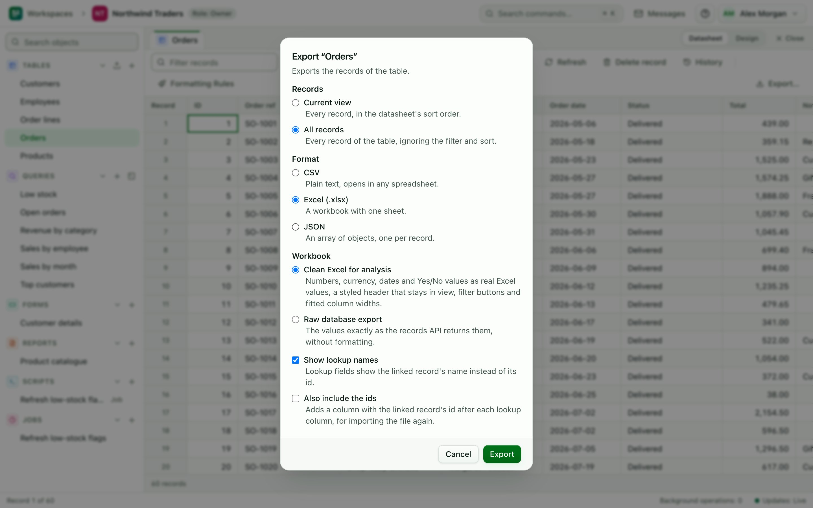

# Imports and exports

Builders and owners import data. Export is available to every role that can see the table or query.

## Import data {#import}

The import wizard has four steps: **File**, **Preview and mapping**, **Check** and **Import**.

1. In the **Tables** group, choose **Import…** to create a new table. To import into an existing table, open its **More actions** menu (the button labelled with the table name and three dots) and choose **Import into this table…**.
2. **File.** Drag a file into the box, or choose one. The file can be up to 100 MiB. Supported formats:
   - CSV, with the delimiter detected for you. A UTF-8 byte-order mark is accepted.
   - Excel (`.xlsx`). The first visible sheet is read.
   - JSON, either one array of objects, or one object per line (NDJSON).
   - GeoJSON (`.geojson`): a FeatureCollection, or a single Feature. Each feature is a row, its properties are columns, and its geometry is a final column named `geometry`. A file of points creates a **Geo point** field, and a file of polygons a **Geo area (fence)** field. Other geometry types (lines) can be read as text but are rejected by a geographic field.

   Under **File options** you can set **Format**, **Delimiter**, **Sheet** and whether **The first row holds column names**. Leave these on automatic unless the preview comes out wrong. Choose **Upload and preview** to continue.
3. **Preview and mapping.** The first rows are shown, and a type is guessed for each column from the first 1,000 rows.
   - For a new table, the **Fields of the new table** table has one row per source column. Choose whether to **Include** it, its **Field name**, its **Type**, and whether it is **Required**.
   - For an existing table, the **Column mapping** table has an **Import into** choice for each source column. Pick the field, or **Skip this column**. Columns with the same name are matched automatically. Attachments fields cannot be filled by an import: a source column mapped to one is ignored, and a note under the table says so.
   - To fill a point field from a latitude column and a longitude column, use **Points from two columns** below the table. Both columns must hold numbers, and a row with neither leaves the point empty. Columns named `lat`/`latitude` and `lon`/`lng`/`longitude` are chosen for you.
   - Choose a **Mode**:

     | Mode | What it does |
     |---|---|
     | Append | Adds every row as a new record. Existing records are left alone |
     | Upsert | Updates the record whose key matches, and adds the rest. Choose the **Key field**; it must have a unique index |
     | Replace | Deletes all existing records first, then adds the imported rows. You must tick **I understand that all existing records will be deleted** |

   - Choose a **Transaction** style:
     - **Chunked (default)** saves rows in batches of 2,000. Rows that fail are skipped, and the batches already saved stay saved if the import is cancelled or interrupted.
     - **All or nothing** saves everything in one transaction, and undoes it all if any row fails. Other people's saves wait until it finishes, so avoid it for very large files.

   Choose **Check rows** to continue.
4. **Check.** AbiData validates the rows and lists the first 100 problems in a table with the row, the column and the problem. Fix the source file or the mapping, and use **Back** to try again. The check cannot see database rules such as unique values. Those are enforced when the rows are saved, so some problems appear only during the import.
5. **Import.** Choose **Import rows**. The import runs in the background. You can choose **Close and keep running** and follow progress in the status bar. **Cancel import** stops it. When it finishes, the result shows the number of rows **Inserted**, **Updated**, **Skipped** and **Errors**, with the list of errors. **Open table** shows the result.

A failed all-or-nothing import leaves your data unchanged. The result says "All or nothing: no rows were changed." A new table created by a failed import is removed. A replace of more than 50,000 rows takes a [restore point](/docs/guide/backups#restore-points) first.

If rows are rejected, the operation ends with [IMPORT_ROW_ERRORS](/docs/reference/errors#import-row-errors).

### Limits {#import-limits}

- Upload size: 100 MiB.
- At most 20 pending imports per workspace.
- A JSON object may have at most 256 keys.
- Uploaded files are kept for up to 24 hours and then deleted.

## Export data {#export}

1. Open the **More actions** menu of a table or saved query and choose **Export…**. On a datasheet, choose **Export…** in the toolbar.
2. On a datasheet, choose which **Records** to export: **Current view** (only the records matching the datasheet's filter, in its sort order) or **All records**. **Current view** is the default while a filter is active; otherwise **All records** is.
3. Choose the **Format**: **CSV**, **Excel (.xlsx)** or **JSON** (an array of objects). A table with a point or area field also offers **GeoJSON**: a FeatureCollection with one feature per record, where the first geographic field is the geometry (empty when the record has none), the record ID is the feature ID and the other fields are properties. It is for tables only, not saved queries. For a query with parameters, fill in the values first.
4. For CSV, leave **Excel compatible (UTF-8 with BOM)** checked if you will open the file in Excel on Windows. It starts the file with a byte-order mark so accented and non-Latin text (é, ü, 北京) shows correctly. Turn it off for tools that do not expect a byte-order mark. Your choice is remembered in this browser. Excel and JSON files are not affected.
5. Choose **Export**. The export runs in the background. When the file is ready the download starts by itself. If it does not, the dialog keeps a **Download** link.

In CSV and Excel files an attachments cell holds the file names separated by `; `. JSON files hold the file ids.

Exports of saved queries are limited to 50,000 rows. Exported files are kept for 30 days.

CSV files protect you from spreadsheet formula injection: text that starts with `=`, `+`, `-`, `@`, a tab or a carriage return is prefixed with an apostrophe. Plain numbers are left alone. Column headers get the same treatment. Importing a CSV with or without the byte-order mark works the same way, so an exported file can be imported again unchanged.

## From scripts {#scripts}

Jobs can read and write files too. See `csv.parse`, `csv.encode` and `staging` in the [Lua API reference](/docs/reference/lua-api#module-staging), and the nightly-load recipe in [Scripts](/docs/guide/scripts#recipe-job).
