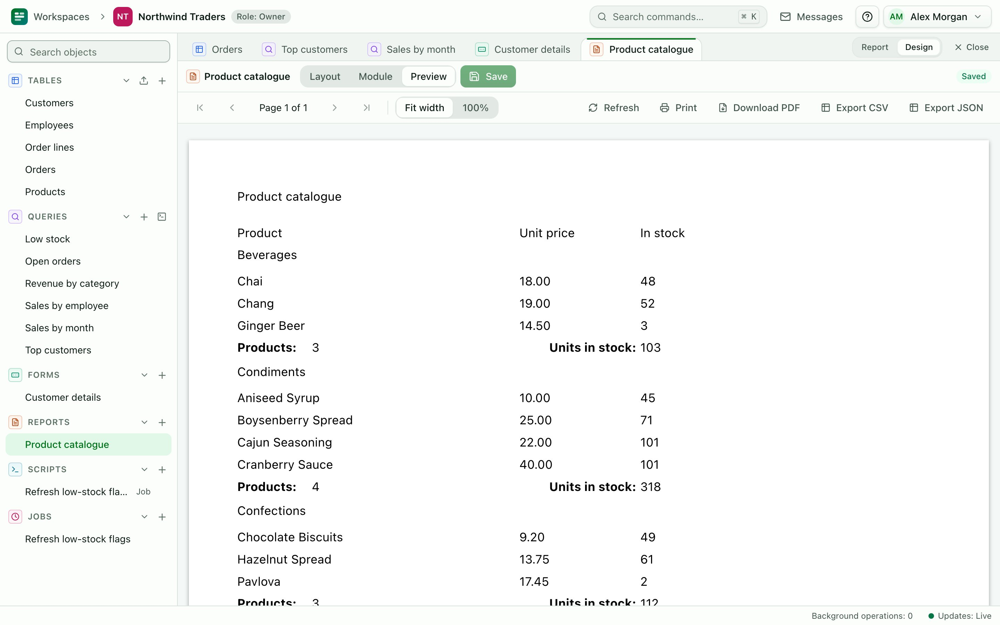

# Reports

A report turns a table or saved query into paginated output with headers, groups and totals. Anyone who can read the data can run a report. Builders and owners design them.

## Create a report {#designer}

1. In the **Reports** group, choose **New report**.
2. Enter a **Report name** and choose the **Record source**: a table or a saved query.
3. Choose a **Layout**:
   - **Blank** starts with empty bands.
   - **Tabular: one row per record** adds every field. Headings go across the top of each page, with one row of values per record. Fields that do not fit the page width continue on a second row.
   - **Columnar: one block per record** adds every field as a block per record, with each field's name beside its value.

   Either way you get a title, the date and page numbers. The detail band can grow, so long text wraps instead of being cut off. Change anything afterwards in the designer.
4. In the page settings, choose the **Paper** (**Letter**, **A4** or **Legal**), the **Orientation** (**Portrait** or **Landscape**) and the margins.
5. Choose a band, then add controls to it from the **Toolbox**, or drag fields from the **Field list**.
6. Choose **Save**. Use the **Preview** panel to see the report with data.

Right-click the design canvas to duplicate, delete or align the selected controls.

Text in a band that cannot grow shows as many whole lines as fit, ending in "…". Point at it to see the full text in the viewer, or turn on **Can grow** for the band.

If the report needs input, base it on a [parameter query](/docs/guide/queries#parameters). Running the report asks for the values. The **Parameters** button in the viewer changes them later.

## Bands {#bands}

A report is divided into horizontal bands. Each band prints at a fixed place:

| Band | Prints |
|---|---|
| Report header | Once, at the start of the report |
| Page header | At the top of every page |
| Group header *n* | Before each group at level *n* |
| Detail | Once per record |
| Group footer *n* | After each group at level *n*, usually totals |
| Page footer | At the bottom of every page |
| Report footer | Once, at the end of the report |

Each band has these settings:

- **Band height**.
- **Can grow**: the band becomes taller when wrapped text needs more room.
- **Keep together**: the band is not split across pages.
- **Force new page**: the band starts on a new page.
- **Visible**.

Controls can be a label, a textbox, a line, a rectangle, an image, a map, and three special controls: **Page number**, **Page count** and **Now**. A textbox's **Control source** is **None (caption text)**, **Field**, **Calculation** or **Aggregate**.

A textbox bound to a Location or Area field prints it like the datasheet: `51.50135, -0.14189` or `Area · 12 points · 3.4 km²`.

### Map controls {#maps}

A **Map** control draws a Location or Area field as a small map, fitted to the value, with a latitude/longitude grid. Choose its **Field**, and optionally an **Overlay query** with a **Geo column** and **Label column** to draw, for example, the zones each sighting is compared with. Maps are drawn as vector graphics, so they print sharply. If an administrator has set a map tile server, the map images are shown on screen only; printed pages and PDFs show the grid.

### Image control {#images}

An **Image** control prints the pictures in an [Attachments field](/docs/guide/tables#attachments). Add it from the **Toolbox**, or add an Attachments field from the **Field list**, which creates an Image control bound to it. Choose the **Attachments field** and set **Images shown**: 1 prints the first image, and a larger number prints a gallery of up to that many images (at most 24), arranged in a grid inside the control's size. Files that are not PNG, JPEG, GIF or WebP images are skipped. A record with no images prints nothing in the control.

Images print as ordinary pictures, so they appear in the print preview and in **Save as PDF**. Give the control a fixed height that suits the band: the band does not grow to fit it. In the viewer, wait for the images to load before printing.

## Grouping and sorting {#grouping}

Open the **Groups and sorting** panel to add group levels and sort orders.

1. Choose **Add group**.
2. Choose the field to group on, or **Expression (Lua)** to group on a Lua expression.
3. Choose **Ascending** or **Descending**.
4. Optionally set the group's **interval**. 0 groups on the whole value. For text, N groups on the first N characters. For numbers, N groups on multiples of N.

Each group adds a header band and a footer band. Put the group's title in the header and its totals in the footer.

To sort the detail rows, choose **Add sort** under **Sort order**, pick a **Sort n field**, and tick **Sort n descending** if needed. Without groups, the records print in this sort order.

## Totals {#totals}

Set a textbox's **Control source** to **Aggregate**, then choose:

- **Function**: **Sum**, **Average**, **Count**, **Minimum** or **Maximum**.
- **Aggregate field**: the field to add up. For **Count**, leave it on **All rows**.
- **Scope**: **Group** totals each group, and **Report** totals the whole report.

Tick **Running total** to accumulate across records instead of starting again for each group.

For a value that is not an aggregate, set **Control source** to **Calculation** and enter a Lua expression over the record's fields, named by their SQL names without `record.`. On a report of **Order lines**, for example, `Quantity * Unit_price`. Functions from the report module are available there too. Report scripts are read-only and have a 30 second budget for the whole run. See [Scripts](/docs/guide/scripts#contexts).

## Print and PDF {#printing}

Open the report and choose **Print**. The report is laid out at its exact paper size, so the print dialog shows the same pages you see on screen.

- To print, pick your printer.
- To make a PDF, choose **Save as PDF** as the destination in the print dialog. Browsers differ in their print options. If the layout is off, set margins to **Default** or **None** and turn headers and footers off.

The paper size and orientation come from the report design. If the dialog shows a different size, set it to match.

## Limits {#limits}

- A report run stops at 200,000 detail records. Add criteria to the source query to reduce them.
- A run takes at most 30 seconds.
- At most two report runs per workspace and four across the server execute at the same time. Others fail with [WORKSPACE_BUSY](/docs/reference/errors#workspace-busy). Try again shortly.
