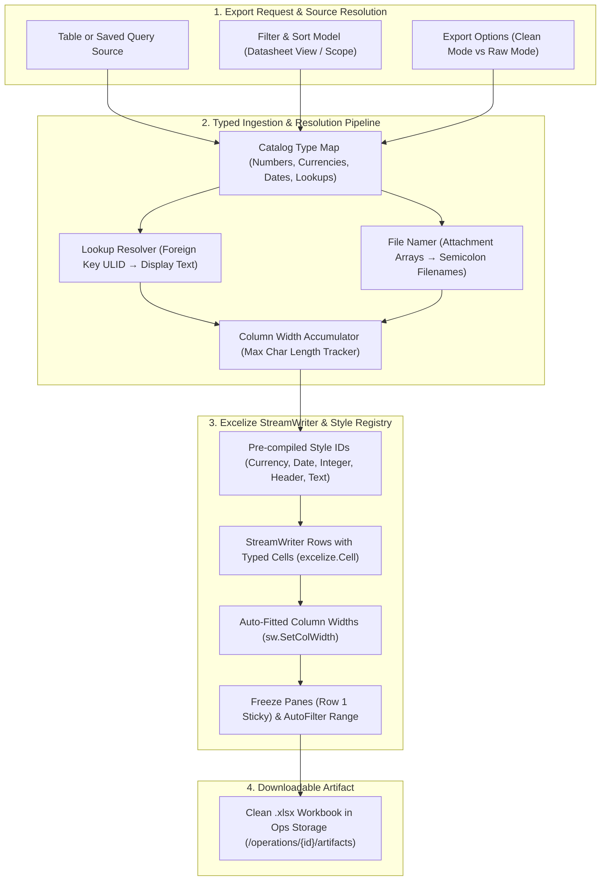

# Specification & Plan: Clean Excel Data Export (Tables & Queries)

- **Target Module:** Data Ingest & Export Engine (`internal/ingest/export.go`, `web/src/features/imports/ExportDialog.tsx`)
- **Related Documents:** [SemVer Versioning Policy](semver-versioning-policy.md), [ADR 0011: File Attachments](../adr/0011-file-attachments.md), [ADR 0013: Backend-Agnostic SQL Layer](../adr/0013-backend-agnostic-sql-layer.md)
- **Status:** Planning / Architecture Review

---

## 1. Executive Summary & Goals

Exporting data to Microsoft Excel (`.xlsx`) is one of the most critical integration surfaces for teams using AbiData. Business analysts, accountants, and executives rely on exported spreadsheets for ad-hoc modeling, reporting, pivot tables, and external sharing.

Currently, AbiData's `xlsxSink` uses `excelize.StreamWriter` to emit basic Excel workbooks. However, current exports suffer from several limitations:
1. **Numbers & Currencies Stored as Text:** Floating-point numbers, decimals, and currencies are written as raw text strings. When opened in Excel, cells show green *"Number stored as text"* error triangles, and basic formulas like `=SUM(C2:C50)` fail.
2. **Dates Stored as ISO Strings:** Date and DateTime values are emitted as plain text strings (`"2026-10-24"`), preventing Excel's native date filters, timeline slicers, and date arithmetic.
3. **Lookup Fields Exported as Opaque IDs:** Lookup relationships emit unreadable foreign key ULIDs (`"01J3K9V..."`) instead of human-readable entity display names (`"Acme Corporation"`).
4. **Unstyled, Unformatted Workbooks:** Exported sheets lack auto-fitted column widths (causing `###` overflow or clipped headers), lack frozen header panes (headers scroll off-screen), and lack AutoFilter dropdowns.

This milestone upgrades AbiData's export engine to produce **production-grade, publication-clean Excel workbooks** for both tables and saved queries.

---

## 2. Architecture & Export Pipeline



---

## 3. Workstream Breakdown

### Workstream 1: Native Cell Types & Pre-Compiled Number Styles

#### 1.1 Problem & Solution
Instead of emitting raw untyped strings to `StreamWriter.SetRow()`, emit structured `excelize.Cell` items referencing pre-registered style definitions.

#### 1.2 Style ID Registry (`xlsxSink`)
In `internal/ingest/export.go`:
```go
type xlsxStyles struct {
    header   int // Bold, light neutral fill (#F1F5F9), thin bottom border (#CBD5E1)
    currency int // NumberFormat: "$#,##0.00" (or custom symbol)
    decimal  int // NumberFormat: "#,##0.00"
    integer  int // NumberFormat: "#,##0"
    percent  int // NumberFormat: "0.0%"
    date     int // NumberFormat: "yyyy-mm-dd"
    datetime int // NumberFormat: "yyyy-mm-dd hh:mm"
    textCode int // NumberFormat: "@" (explicit text to protect leading zeros)
}
```

#### 1.3 Typed Cell Mapping per Catalog Field Type
| AbiData Field Type | Excel Cell Value | Excel Style / NumberFormat | Behavior in Excel |
|---|---|---|---|
| `Currency` | `float64(cents) / 10000.0` | `xlsxStyles.currency` (`$#,##0.00`) | Native number; `=SUM()` works instantly |
| `Number` / `Calculated (numeric)` | `float64` | `xlsxStyles.decimal` (`#,##0.00`) | Native decimal with proper precision |
| `Integer` / `Autonumber` | `int64` | `xlsxStyles.integer` (`#,##0`) | Formatted integer with commas |
| `Date` | Excel date serial (`days since 1899-12-30`) | `xlsxStyles.date` (`yyyy-mm-dd`) | Real date; timeline & month filters work |
| `DateTime` | Excel datetime serial | `xlsxStyles.datetime` (`yyyy-mm-dd hh:mm`) | Real timestamp with hour/minute display |
| `YesNo` | `bool` | Built-in boolean | Native `TRUE` / `FALSE` |
| `ShortText` (numeric codes) | `string` | `xlsxStyles.textCode` (`@`) | Preserves leading zeroes (`"00142"`) |
| `Hyperlink` | `string` | Built-in hyperlink | Clickable URL |

---

### Workstream 2: Human-Readable Lookup Resolution

#### 2.1 Problem
In `exportTable`, lookup columns store foreign keys (`"01J3K9V..."`). Exporting these leaves spreadsheets unreadable unless the user manually runs queries with joins.

#### 2.2 Lookup Resolution Pipeline (`lookupResolver`)
Analogous to `fileNamer` in `export_files.go`:
- Inspect all columns where `c.Type == catalog.Lookup`.
- Extract relationship parent table and target display column.
- Pre-cache or batch-resolve foreign keys to target display values in chunks of 500 keys using `l.Read()`:
  ```go
  type lookupResolver struct {
      colIdx   map[int]lookupMapping
      cache    map[string]string // foreignKeyID -> displayText
  }
  ```
- **Export Options in `ExportRequest`:**
  - `ResolveLookups *bool`: Default `true` for XLSX and CSV.
  - When true, cells contain `"Acme Corporation"` instead of `"01J3K9V..."`.

---

### Workstream 3: Professional Presentation (Panes, Filters & Column Widths)

#### 3.1 Auto-Fitted Column Widths
- As rows are streamed, track maximum character width per column:
  `colWidths[c] = max(colWidths[c], len(cellString))`
- Sample the header and first 1,000 rows.
- Prior to finalizing workbook:
  ```go
  for c, maxLen := range colWidths {
      width := math.Min(math.Max(float64(maxLen + 4), 12.0), 60.0)
      _ = x.sw.SetColWidth(c + 1, c + 1, width)
  }
  ```
- **Benefit:** Columns never open clipped or displaying `###`.

#### 3.2 Sticky Frozen Header Row
- Freeze row 1 on Sheet1:
  ```go
  _ = x.f.SetPanes("Sheet1", &excelize.Panes{
      Freeze:      true,
      Split:       true,
      XSplit:      0,
      YSplit:      1,
      TopLeftCell: "A2",
      ActivePane:  "bottomLeft",
  })
  ```
- **Benefit:** When scrolling through 50,000 records, the column headers remain pinned.

#### 3.3 Header AutoFilter Range
- Enable Excel AutoFilter dropdowns across the header row:
  ```go
  lastColName, _ := excelize.CoordinatesToCellName(len(cols), 1)
  _ = x.f.AutoFilter("Sheet1", "A1", lastColName, nil)
  ```
- **Benefit:** Users can instantly filter and sort records directly in Excel with one click.

---

### Workstream 4: High-Fidelity Query Exports

#### 4.1 Type Sniffing on Saved Query Results
Unlike table exports where schema metadata is explicit, saved queries return `[]string` column names and `[][]any` rows.
- For query exports, inspect column sample values:
  - If a column contains only integers $\rightarrow$ format as Integer.
  - If a column matches ISO date format $\rightarrow$ convert to Excel Date serial.
  - If a column matches decimal currency strings $\rightarrow$ convert to Numeric.

#### 4.2 Query Information Sheet (Optional Audit Tab)
- Add optional secondary tab `"Query Details"`:
  - Query Name & Workspace
  - Executed SQL Statement
  - Runtime Parameters Applied
  - Execution Timestamp & User
  - Total Record Count

---

### Workstream 5: Export Dialog UX Refinements (`ExportDialog.tsx`)

#### 5.1 Export Dialog Enhancements
When `xlsx` is selected in `ExportDialog.tsx`:
1. **Formatting Mode Selection:**
   - `[x] Clean Excel (formatted numbers, dates, resolved lookup names, sticky headers)` *(Recommended default)*
   - `[ ] Raw Database Export (unformatted strings, raw foreign key IDs)`
2. **Export Scope Selection (when opened from Datasheet):**
   - `Selected records (e.g. 18 rows)` *(active selection range)*
   - `Filtered view (e.g. 142 rows)` *(active filters and sorting)*
   - `Entire table (e.g. 12,450 rows)`

---

## 4. Implementation Phasing

| Phase | Milestone | Scope | Files |
|:---|:---|:---|:---|
| **E1** | **Native Styles & Cell Typing** | Pre-compile Excel styles; stream typed cells for currency, date, numbers | `internal/ingest/export.go` |
| **E2** | **Lookup Resolver** | Batch-resolve lookup foreign keys to human display names | `internal/ingest/export_lookups.go` |
| **E3** | **Layout & AutoFilter** | Auto-fit column widths, freeze row 1 panes, enable AutoFilter | `internal/ingest/export.go` |
| **E4** | **Query Type Sniffing** | Infer numeric and date types for saved query exports | `internal/ingest/export.go` |
| **E5** | **Export Dialog Options** | Scope selection (selected vs filtered vs all), clean vs raw toggle | `web/src/features/imports/ExportDialog.tsx` |

---

## 5. Automated Verification Gates

1. **Go Unit & Invariant Tests (`internal/ingest/export_test.go`):**
   - Assert that exported `.xlsx` files contain typed numeric cells (`t="n"`), currency formats, and valid date serial numbers.
   - Assert that lookup columns contain resolved display names instead of foreign key ULIDs.
   - Assert that formula-looking text is properly escaped without breaking numeric negatives.
2. **Playwright E2E Tests (`tests/e2e/exports.spec.ts`):**
   - Export a table to `.xlsx` with currency, date, and lookup fields.
   - Inspect the downloaded workbook structure: verify Sheet1 has frozen panes, AutoFilter enabled, and non-zero column widths.
   - Verify that "Selected rows only" exports exactly the chosen range.
