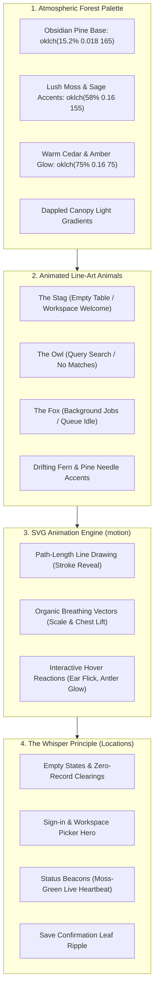

# Specification & Plan: "Sylvan Atelier" — Forest & Wildlife Visual Theme & Animated SVG Line Art

- **Target Module:** Design System, Themes & Empty States (`web/src/styles/tokens.css`, `web/src/components/illustrations/`, `web/src/components/ui/EmptyState.tsx`)
- **Status:** Planning / Creative Direction
- **Creative Theme:** **"Sylvan Atelier"** — A bespoke, serene forest aesthetic blending Scandinavian minimalism, deep obsidian pine tones, mist-dappled lighting, and elegant, living SVG line-art wildlife (deer, owls, foxes, pine canopies).
- **Core Library:** `motion` (`framer-motion`) for vector path-drawing, breathing spring physics, and line animations.
- **Design Rule:** **"The Whisper Principle"** — Nature flourishes in empty states, ambient lighting, badges, and status beacons without ever cluttering or distracting from high-performance data entry in grids or editors.

---

## 1. Executive Summary & Creative Vision

AbiData is evolving from a functional database tool into a uniquely crafted, memorable workspace. Rather than settling for generic tech-minimalism, this plan infuses the application with the tranquil, grounded elegance of **lush forests and living wildlife**:
- **Palette & Atmosphere:**
  - Dark Mode: **Obsidian Pine & Moss** — deep midnight graphite undertones with deep spruce and pine accents, warm amber woodlight, and morning mist reflections.
  - Light Mode: **Misty Birch & Sage** — clean alabaster paper surfaces balanced with crisp forest-emerald accents, warm cedar details, and dappled canopy lighting.
- **Animated Vector Line-Art Wildlife:**
  - Introducing bespoke line-art animal figures: a serene **Stag / Deer** in lush clearings, a watchful **Owl** for queries and search states, a nimble **Fox** for jobs and scheduler queues, and drifting pine/leaf accents.
  - Powered by **`motion` (framer-motion)** for smooth stroke-drawing animations (`pathLength`), breathing micro-movements, and interactive hover life.

---

## 2. The Sylvan Design Language



---

## 3. Workstream Breakdown

### Workstream 1: "Obsidian Pine & Sage" Color Grading (`tokens.css`)

#### 1.1 Dark Mode ("Obsidian Pine")
Replace flat charcoal with a deep, atmospheric evergreen graphite:
```css
:root[data-theme="dark"] {
  /* Deep pine-infused obsidian base */
  --bg: oklch(15.2% 0.018 165);
  --surface: oklch(18.5% 0.020 162);
  --surface-2: oklch(21.8% 0.023 160);
  --surface-3: oklch(25.5% 0.026 158);
  --border: oklch(28.2% 0.024 158);
  --border-strong: oklch(50.5% 0.032 155);

  /* Primary Accent: Luminous Spruce Emerald */
  --accent: oklch(68.5% 0.17 155);
  --accent-hover: oklch(75.2% 0.14 157);
  --accent-soft: oklch(26.5% 0.055 158);
  --accent-fg: oklch(15.2% 0.018 165);

  /* Warm Cedar & Campfire Amber (Warnings & Activity) */
  --warning: oklch(78.5% 0.16 75);
  --warning-soft: oklch(27.0% 0.048 75);

  /* Forest Mist Shadows */
  --shadow-color-1: oklch(0% 0 0 / 0.35);
  --shadow-color-2: oklch(0% 0 0 / 0.45);
}
```

#### 1.2 Light Mode ("Misty Birch")
- Base background: Alabaster with a subtle hint of mountain mist (`oklch(97.6% 0.005 160)`).
- Surfaces: Crisp clean white with fine moss-tinted borders.
- Primary Accent: Deep Pine Forest (`oklch(46.5% 0.18 152)`).

#### 1.3 Dappled Canopy Gradient Wash
Add a subtle organic background ambient gradient to hero headers and empty screens:
```css
.bg-canopy {
  background-image:
    radial-gradient(ellipse at 85% 15%, oklch(var(--accent) / 0.07) 0%, transparent 60%),
    radial-gradient(ellipse at 15% 85%, oklch(var(--warning) / 0.04) 0%, transparent 60%);
}
```

---

### Workstream 2: The Animated Line-Art Wildlife Collection (`web/src/components/wildlife/`)

#### 2.1 The Library Choice: `motion` (Framer Motion)
Install `motion` (lightweight, modular bundle from the makers of Framer):
- Enables native `<motion.svg>` and `<motion.path>`.
- Hardware-accelerated stroke drawing via `pathLength: [0, 1]`.
- Organic spring physics with zero layout thrashing.
- Fully tree-shakeable.

#### 2.2 Wildlife Vector Suite
1. **The Forest Stag (`DeerIllustration.tsx`):**
   - **Art Style:** Minimalist, continuous single-line or slender dual-line vector art of a stag standing proudly among gentle pine silhouettes.
   - **Animation:**
     - On Mount: Path lines draw themselves smoothly from hooves to antlers over 1.8 seconds.
     - Idle State: Subtle, gentle breathing loop (slight 1.5px vertical chest expansion every 4s).
     - Hover/Focus: A soft ambient glow illuminates the antlers, and one ear gently swivels.
   - **Usage:** Primary Table Empty State, Welcome Splash, Workspace Onboarding.
   - **Copy:** *"The clearing is quiet. Add your first record or import data to begin."*

2. **The Watchful Owl (`OwlIllustration.tsx`):**
   - **Art Style:** Stylized, geometric line-art owl perched on a slender pine branch.
   - **Animation:**
     - Eyes softly blink or open wide when search input receives focus.
     - Head tilts subtly with an organic spring on hover.
   - **Usage:** Query Results Empty State, Search Filter No-Match State.
   - **Copy:** *"Searching through the branches... No matching records found."*

3. **The Nimble Fox (`FoxIllustration.tsx`):**
   - **Art Style:** Sleek, low-line vector fox resting gracefully with tail curled.
   - **Animation:**
     - Gentle tail wag loop with spring easing.
     - Lifts head slightly when background job scheduler starts.
   - **Usage:** Background Jobs & Automations Empty/Idle State.
   - **Copy:** *"All trails are quiet. Scheduled tasks are resting."*

4. **The Whispering Pines (`PineCanopyIllustration.tsx`):**
   - Minimalist line-art mountain and pine tree ridge used as an atmospheric header banner in the Workspace Picker and Sign-in views.

---

### Workstream 3: Organic Micro-Details Across the UI

#### 3.1 Breathing "Forest Beacon" Connection Indicator
In `WorkspaceShell.tsx`:
- When connected (`live`):
  - A glowing emerald moss dot with an organic double-wave ping ring:
    ```tsx
    <span className="relative flex h-2.5 w-2.5 items-center justify-center">
      <motion.span
        animate={{ scale: [1, 1.8, 1], opacity: [0.6, 0, 0.6] }}
        transition={{ repeat: Infinity, duration: 3.5, ease: "easeInOut" }}
        className="absolute h-full w-full rounded-full bg-success/40"
      />
      <span className="h-2 w-2 rounded-full bg-success shadow-[0_0_8px_var(--color-success)]" />
    </span>
    ```
  - Feels like a living heartbeat.

#### 3.2 Save Confirmation "Forest Ripple"
- When a user saves a record in the datasheet or form:
  - An ephemeral, soft emerald-mist wave washes across the record card/row (`bg-emerald-500/15 -> transparent` over 1,200ms).
  - Confirms the write with reassuring, living feedback.

#### 3.3 Botanical Jewel Badges
Update the kind badge tokens:
- Tables: Mountain Lake Sapphire
- Queries: Night Sky Violet
- Forms: Lush Fern Emerald
- Reports: Autumn Wood Amber
- Scripts: Glacier Cyan
- Jobs: Wild Rose Coral

---

## 4. Implementation Phasing & Milestones

| Sequence | Milestone | Deliverables | Target Files |
|:---|:---|:---|:---|
| **W1** | **Library Setup & Tokens** | Add `motion` dependency; configure Obsidian Pine & Misty Birch palettes | `package.json`, `tokens.css` |
| **W2** | **Animated Stag Illustration** | Line-art Deer vector with path drawing & breathing loop; Table EmptyState | `DeerIllustration.tsx`, `EmptyState.tsx` |
| **W3** | **Owl & Fox Illustrations** | Query search Owl and Job Fox vector animations with interactive triggers | `OwlIllustration.tsx`, `FoxIllustration.tsx` |
| **W4** | **Canopy Ambient Headers** | Dappled light gradients and mountain pine silhouettes on picker/sign-in | `WorkspacePicker.tsx`, `SignIn.tsx` |
| **W5** | **Living Micro-Interactions** | Breathing emerald beacon, forest save ripple, botanical jewel badges | `WorkspaceShell.tsx`, `objectKinds.tsx` |

---

## 5. Non-Negotiable Standards & Invariants

1. **The Whisper Rule (No Distraction):**
   - Animated wildlife is confined to **Empty States, Splash Screens, and Modals**.
   - Active data grids, code editors, and data entry forms remain 100% clean, crisp, and high-density without decorative clutter.
2. **Reduced Motion Respect:**
   - Full compliance with `@media (prefers-reduced-motion: reduce)`.
   - `motion` automatically honors user OS settings; animations freeze into elegant static line art when reduced motion is preferred.
3. **Bundle & Performance Ceiling:**
   - `motion` imports are tree-shaken (using `m` and `LazyMotion` if needed).
   - SVG vectors are pure code (< 3KB each), requiring zero external bitmap assets.
   - Framerate strictly locked at 60 FPS.
