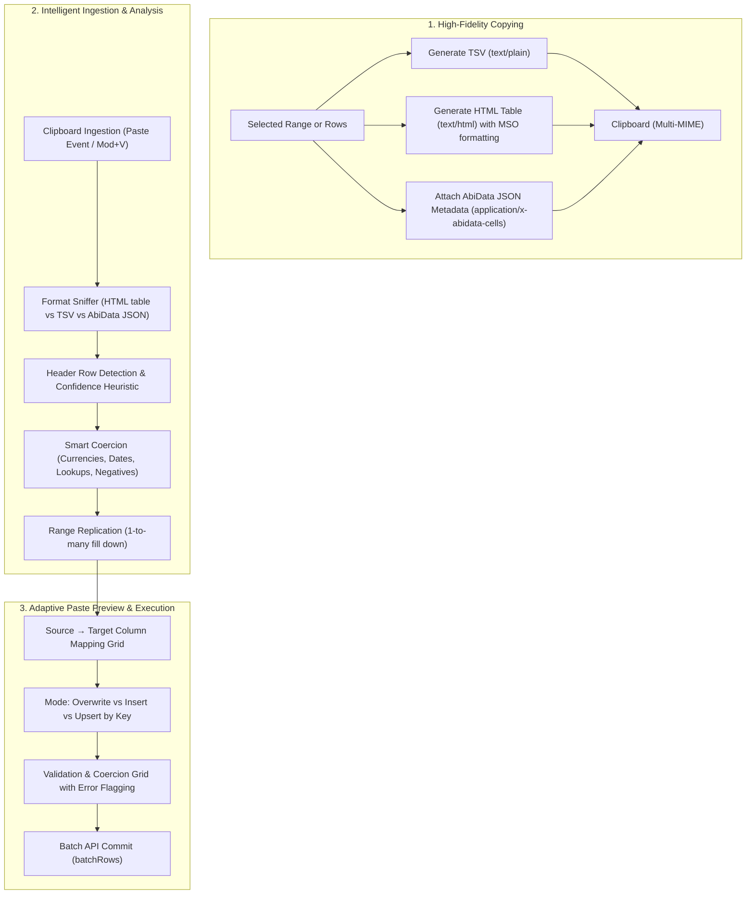

# Specification & Plan: Intelligent Copy & Paste (Excel Interoperability & Cross-Table Transfer)

- **Target Module:** Datasheet, Query Results & Clipboard Engine (`web/src/features/datasheet/`, `web/src/lib/clipboard.ts`)
- **Related Documents:** [Phase 4 Datasheet Plan](phase-4-data-exploration-and-datasheet.md), [ADR 0015: Web UI Modernisation](../adr/0015-web-ui-review-and-modernisation.md)
- **Status:** Planning / Architecture Review

---

## 1. Executive Summary & Goals

Data operators and business analysts frequently move information between spreadsheet tools (Microsoft Excel, Google Sheets) and AbiData, as well as between different tables within AbiData (e.g., migrating qualified leads from `Prospects` into `Customers`, or duplicating order line templates).

While AbiData recently gained multi-cell range selection (`CellRange`) and basic TSV clipboard paste (`PastePreviewDialog`), real-world spreadsheet interoperability requires significant intelligence:
1. **High-Fidelity Copying to Excel:** Generating dual-flavor clipboard payloads (`text/plain` TSV and `text/html` `<table>`) preserving column headers, numeric formats, and string zero-padding so Excel doesn't corrupt data (e.g., stripping leading zeros in ZIP codes).
2. **Intelligent Excel Parsing:** Detecting header rows, auto-mapping pasted columns to target table fields, resolving lookup display values to foreign keys, and gracefully parsing heterogeneous dates, currencies, and accounting negative numbers `(1,234.50)`.
3. **Cross-Table Transfers:** Copying rows from Table A and pasting into Table B with schema-aware column matching, skipping immutable system fields, and supporting key-based upserts.
4. **Excel-Style Fill & Range Replication:** Replicating a single cell or row across an expanded selection range (e.g. copying "Active" into 50 selected rows).

---

## 2. Architecture & Workflow



---

## 3. Workstream Breakdown

### Workstream 1: High-Fidelity Multi-MIME Clipboard Copying

#### 1.1 Multi-MIME Payload Generation
In `web/src/lib/clipboard.ts` and `range.ts`:
- Replace single-text `writeText` with `navigator.clipboard.write([new ClipboardItem(...)])` when supported.
- Provide three clipboard flavors simultaneously:
  1. **`text/plain`**: Clean RFC 4180 TSV for terminal, text editors, and simple tools.
  2. **`text/html`**: Semantic HTML table (`<table><tr><td>`) with Excel-specific styling:
     - `style="mso-number-format:'\@'"` on text/identifier columns (prevents Excel from converting `"00142"` to integer `142` or `"1-4"` to date `Jan-04`).
     - `style="mso-number-format:'\$#,##0.00'"` on currency columns.
     - `style="font-weight: bold; background-color: #f3f4f6;"` on header rows.
     - `style="text-align: right;"` on numeric cells.
  3. **`application/x-abidata-cells` (or fallback JSON comment in HTML)**:
     - Carries structured metadata:
       ```json
       {
         "source_table_id": "01J...",
         "source_table_name": "Invoices",
         "columns": [
           { "id": "col_1", "name": "invoice_no", "display_name": "Invoice #", "type": "short_text" },
           { "id": "col_2", "name": "total", "display_name": "Total Amount", "type": "currency" }
         ],
         "rows": [ ...raw field values... ]
       }
       ```

#### 1.2 "Copy with Headers" Action
- Shortcut: `Mod+Shift+C` (or context menu item `"Copy with headers"`).
- Automatically prepends the active column display names as the first row of the TSV and HTML table.

---

### Workstream 2: Smart Excel Parser & Type Normalization

#### 2.1 Multi-Line HTML & TSV Extraction
- When `ClipboardEvent` provides `text/html`, parse cells directly from the DOM using a lightweight virtual parser:
  - Preserves cell line breaks (`<br>` or `\n` inside cells) without breaking row delimiters.
  - Strips unwanted Excel junk tags while preserving clean text values.

#### 2.2 Intelligent Type Coercion Engine (`paste.ts`)
Upgrade `convertPaste` with robust real-world parsing rules:
- **Currency & European Numbers:**
  - Strip arbitrary international currency signs: `$`, `€`, `£`, `¥`, `₹`, `CHF`, `kr`, `R$`.
  - Accounting parentheses: `(1,234.50)` $\rightarrow$ `-1234.50`.
  - Auto-detect European decimal separator notation: if a string has dots as thousands separators and a comma before two decimals (e.g. `1.234,50`), parse to `1234.50`.
- **Date & DateTime Ingestion:**
  - Common spreadsheet formats:
    - `MM/DD/YYYY` (US standard)
    - `DD/MM/YYYY` (European standard, resolved with workspace locale context)
    - `YYYY-MM-DD` (ISO)
    - Named months: `24-Oct-2026`, `Oct 24, 2026`
    - Excel serial numbers: e.g. `45589` $\rightarrow$ `2024-10-24` (days since 1899-12-30).
- **Lookup & Foreign Key Resolution:**
  - Currently: Lookup fields are skipped (`"Lookup fields cannot be pasted yet"`).
  - **New Behavior:**
    - Query the target table's cached lookup display dictionary.
    - If the pasted text matches an existing related record's display name (e.g. `"Acme Supplies Ltd"`), automatically resolve to its foreign key ID `01J...`.
    - If no match or ambiguous match, mark as an error with inline suggestion.
- **Booleans:**
  - `TRUE`, `FALSE`, `T`, `F`, `YES`, `NO`, `Y`, `N`, `1`, `0`, `✓`, `✗`, `CHECKED`, `UNCHECKED`.

---

### Workstream 3: Header Detection & Adaptive Column Mapping

#### 3.1 Header Row Detection Heuristic
When the pasted matrix has 2 or more rows:
- Compare row 0 against target table columns:
  - Exact match on `name` or `display_name` (case-insensitive).
  - Normalized match (stripping spaces, underscores, punctuation: `"order_date"` $\rightarrow$ `"Order Date"`, `"Phone #"` $\rightarrow$ `"Phone"`).
- If $\ge 50\%$ of row 0 matches table column names:
  - Mark `hasHeaderRow = true` by default.
  - Automatically map source columns to matched target columns (even if order in Excel differs from table layout!).
  - Exclude row 0 from data writes.

#### 3.2 Visual Column Remapping Grid in `PastePreviewDialog`
- When column mismatch or header detection occurs, render a mapping strip:
  ```
  [Excel Column]          [Action]         [Target Table Field]
  -------------------------------------------------------------
  "Customer Name"   ───>   Maps to   ───>   Customer [Lookup]
  "Total USD"       ───>   Maps to   ───>   Amount [Currency]
  "Internal Code"   ───>   Skip      ───>   (Ignore column)
  ```
- Builders can remap any column via a dropdown or toggle "Ignore column".

---

### Workstream 4: Cross-Table Transfers & Upsert Mechanics

#### 4.1 Cross-Table Paste (Table A $\rightarrow$ Table B)
- When pasting data originating from another table within AbiData:
  - The clipboard carries `application/x-abidata-cells` containing column identifiers and names.
  - Columns with identical names or compatible types automatically map.
  - System columns (`id`, `_version`, `_created_at`, `_updated_at`) are automatically stripped so new valid records are created.

#### 4.2 Paste Modes: Insert, Overwrite, and Keyed Upsert
Extend `PasteMode` from `{ "overwrite", "insert" }` to:
- `insert`: Appends all rows as new records.
- `overwrite`: Overwrites contiguous cells starting from active cell coordinates.
- `upsert` *(New)*:
  - When the target table has a unique column (e.g. `Email`, `SKU`, `Customer ID`) present in the pasted data:
  - User can select: `"Update existing records matching on [SKU], insert new records otherwise"`.

---

### Workstream 5: Excel-Style Fill & Range Replication

#### 5.1 Single-Value & Single-Row Replication
- **Single Cell into Selection:**
  - If clipboard contains 1 cell and user has selected a multi-cell range (e.g. 10 rows $\times$ 3 columns), replicate the value across all 30 target cells.
- **Single Row into Multi-Row Selection:**
  - If clipboard contains 1 row of $K$ columns and user selects $M$ rows of $K$ columns, replicate the row down across all $M$ rows.
- **Direct Paste for Clean 1-Cell Pastes:**
  - Single-cell paste into an active cell applies immediately with standard undo (`Mod+Z`), bypassing the modal dialog for zero-friction typing.

---

## 4. Implementation Phasing & Milestones

| Step | Milestone | Files Modified | Verification |
|:---|:---|:---|:---|
| **P1** | **Multi-MIME Copy Engine** | `web/src/lib/clipboard.ts`, `range.ts`, `DatasheetView.tsx` | Vitest clipboard goldens, Excel / Sheets paste fidelity |
| **P2** | **Smart Coercion & Normalizers** | `web/src/features/datasheet/paste.ts`, `values.ts` | Unit tests for currencies, European dates/numbers, booleans |
| **P3** | **Lookup Field Auto-Resolution** | `paste.ts`, `rowsApi.ts`, `PastePreviewDialog.tsx` | Vitest lookup resolution, E2E lookup paste test |
| **P4** | **Header Detection & Column Mapping** | `paste.ts`, `PastePreviewDialog.tsx` | Visual mapping grid tests, fuzzy matching tests |
| **P5** | **Range Replication & Direct Paste** | `DatasheetView.tsx`, `Grid.tsx`, `range.ts` | Playwright range fill down tests, keyboard shortcuts |

---

## 5. Security & Invariant Guarantees

1. **Transactional Integrity:** All batch pastes continue to execute atomically inside a single SQLite/PostgreSQL transaction via `batchRows()`.
2. **Quota Enforcement:** `MAX_PASTE_ROWS` remains bounded at 1,000 records per operation to preserve writer lock constraints and memory ceilings.
3. **Optimistic Concurrency Control (OCC):** Overwriting rows requires valid `_version` checks; concurrent writes prompt the standard merge dialog rather than silently overwriting foreign edits.
4. **Input Sanitization:** Multi-line HTML clipboard data is parsed via safe DOM text extraction (`DOMParser` with inert document), never `innerHTML` injection.
