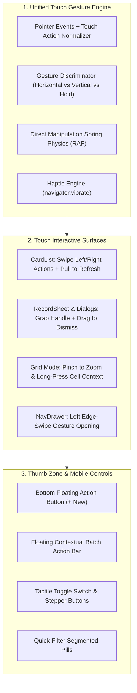

# Specification & Plan: Mobile UI & Advanced Touch Actions Overhaul

- **Target Module:** Mobile Experience & Touch Gestures (`web/src/features/datasheet/`, `web/src/features/nav/`, `web/src/styles/mobile.css`, `web/src/lib/touchErgonomics.ts`)
- **Status:** Planning / Architecture Review
- **Design Philosophy:** "Thumb-Zone Ergonomics & Tactile Fluidity" — Move critical actions into natural thumb reach, replace tap-only patterns with direct-manipulation touch gestures (swipe actions, drag-to-dismiss, pull-to-refresh, long-press multi-select), and optimize mobile input controls for field operations.
- **Related Documents:** [Phase 3 Plan (Baseline Touch)](phase-3-mobile-touch-and-forms.md), [Visual Design Overhaul](ui-and-style-overhaul.md), [DESIGN.md](../../web/src/components/DESIGN.md) §9 (Mobile)

---

## 1. Executive Summary & Goals

Field workers, inspectors, logistics coordinators, and mobile executives frequently operate AbiData on iPhones, Android smartphones, and iPad/Android tablets. While Phase 3 established baseline mobile support (responsive drawer, basic record cards, full-screen record sheet, and card pagination swiping), mobile interactions currently remain predominantly "desktop-on-a-small-screen" — requiring precise finger taps on small icon buttons, reaching into the top corners of tall devices, and lacking standard touch actions expected on modern touch devices.

This overhaul introduces **six comprehensive touch interaction pillars**:
1. **Swipe Actions on Cards & Lists:** Swipe-left to reveal quick actions (Delete, Edit, Duplicate) or full-swipe to delete; swipe-right to toggle status or star.
2. **Sheet Drag-to-Dismiss:** Direct-manipulation vertical swipe down with pull handle and rubber-band physics to close record sheets and modal dialogs.
3. **Pull-to-Refresh:** Elastic pull-down gesture on record lists and query results to refresh live data without hunting for toolbar refresh buttons.
4. **Long-Press Multi-Select Mode:** Long-press any card to activate batch selection mode with a floating bottom action bar (Batch Delete, Export, Tag).
5. **Thumb-Zone Bottom Navigation & FAB:** Relocating primary mobile actions (`+ New Record`, search, view toggle) into the lower thumb zone for comfortable one-handed use.
6. **Touch-First Input Controls:** Tactile toggle switches (replacing tiny checkboxes), numeric stepper buttons (`-` / `+`), and native date sheets.

---

## 2. Touch Gesture Architecture



---

## 3. Workstream Breakdown

### Workstream 1: Swipeable Record Cards (`CardList.tsx`, `useCardSwipeActions.ts`)

#### 1.1 Problem & Opportunity
Currently, tapping a record card in `CardList` opens the record sheet, but cards have zero horizontal touch actions. To delete, duplicate, or inspect history, users must tap to open the sheet, tap the "More actions" dropdown, and select the item.

#### 1.2 Swipe-Action Mechanics
Introduce a swipeable card wrapper (`SwipeableCard.tsx`):
- **Swipe Left (Destructive / Secondary Actions):**
  - **Partial Swipe ($> 70\text{px}$):** Reveals two action tiles:
    - **Edit** (blue tile with pencil icon)
    - **Delete** (red tile with trash icon)
  - **Full Swipe ($> 65\%$ card width):** Triggers immediate delete with spring animation and an ephemeral bottom undo toast (`"Record deleted. Undo"` for 5 seconds).
- **Swipe Right (Primary Quick Action):**
  - Configurable quick action: Star/Bookmark, Mark Complete, or custom status toggle with green tile reveal.
- **Physics & Haptics:**
  - Direct 1:1 translation with smooth cubic-bezier snap back if released below trigger threshold.
  - Light haptic vibration (`navigator.vibrate(10)`) when crossing the action threshold.
  - Only one card can be in an open/swiped state at a time; tapping anywhere else resets open cards.

---

### Workstream 2: Direct-Manipulation Drag-to-Dismiss (`RecordSheet.tsx`, `mobile.css`)

#### 2.1 Problem
`RecordSheet` and bottom dialogs currently require tapping an `X` or "Cancel" button in the upper corners—the hardest reach zone on modern 6.7-inch phones.

#### 2.2 Specification & Behavior
- **Visual Affordance (Pull Handle):**
  - Centered at the top of bottom sheets and `RecordSheet`:
    `w-10 h-1.5 rounded-full bg-border-strong/40 mx-auto my-2 touch-none`
- **Drag Interaction Physics (`useDragToDismiss.ts`):**
  - Pointer down on the header or handle initiates vertical tracking:
    - Downward drag: Translates the sheet in real-time (`transform: translate3d(0, dy, 0)`).
    - Upward drag: Elastic rubber-band resistance ($0.2 \times dy$).
  - **Dismissal Thresholds:**
    - Dragged downward $> 25\%$ of sheet height **or** released with velocity $> 0.5\text{px/ms} \rightarrow$ animate sheet off-screen and trigger `onClose()`.
    - Otherwise, snap back to center with a 200ms ease-out spring.
- **Unsaved Changes Guard:**
  - If the record has unsaved edits (`hasChanges === true`), reaching the dismiss threshold pauses and presents the standard discard confirmation prompt before closing.

---

### Workstream 3: Pull-to-Refresh Gesture (`usePullToRefresh.ts`)

#### 3.1 Problem
When operating in the field, mobile network connections fluctuate. Users frequently need to check for updated records, but the only refresh button is hidden in desktop toolbars.

#### 3.2 Specification & Behavior
- Available on `CardList`, `FormInstance`, and `QueryResultsGrid` when scrolled to the very top (`scrollTop === 0`):
  - Pulling downward past the top boundary smoothly reveals a circular refresh indicator with a rotating arrow.
  - Reaching $60\text{px}$ travel triggers a light haptic cue (`navigator.vibrate(8)`) and rotates arrow to complete circle.
  - Releasing executes `refreshData()`, spinning smoothly until TanStack Query completes, then collapsing cleanly.
  - Implemented via `touch-action: pan-y` and overscroll physics without interfering with native browser overscroll.

---

### Workstream 4: Long-Press Multi-Select Mode

#### 4.1 Problem
Selecting multiple records to batch-delete or export currently requires desktop grid checkboxes. Mobile cards only support opening one record at a time.

#### 4.2 Specification & Workflow
- **Activation Gesture:**
  - Pressing and holding any record card for $500\text{ms}$ without moving ($< 10\text{px}$ drift) activates **Multi-Select Mode**.
  - Medium haptic buzz (`navigator.vibrate(25)`).
- **Visual Mode Transition:**
  - Circular selection checkboxes slide in on the left edge of every card.
  - The held card is immediately checked.
  - Top header switches to selection count (`"3 records selected"` with "Cancel" button).
- **Floating Bottom Action Bar:**
  - A sleek floating pill bar slides up from the bottom safe area:
    ```text
    +-------------------------------------------------------------+
    | [✓ 3 Selected]   [📋 Duplicate]   [📤 Export]   [🗑️ Delete]   |
    +-------------------------------------------------------------+
    ```
  - Tapping additional cards toggles selection with light haptics.
  - Pressing "Delete" prompts for batch deletion confirmation.

---

### Workstream 5: Thumb-Zone Bottom Bar & Floating Action Button (FAB)

#### 5.1 One-Handed Ergonomics
On tall smartphones, bottom-anchored controls drastically reduce drop risk and fatigue.

#### 5.2 Floating Bottom Action Bar (`MobileBottomBar.tsx`)
In `DatasheetTab` and `WorkspaceShell` on compact viewports:
- **Floating Action Button (FAB):**
  - Large rounded-full button anchored in the bottom right corner:
    `h-14 w-14 rounded-full bg-accent text-accent-fg shadow-lg flex items-center justify-center`
    Icon: `Plus` (44px touch target). Tapping opens `RecordSheet` in new record mode.
- **Bottom Navigation Dock:**
  - Pinned above the home indicator (`env(safe-area-inset-bottom)`):
    - **Menu** (opens navigation drawer)
    - **Search** (opens floating search bar)
    - **View Toggle** (instant switch between Cards and Grid mode)
    - **Active Tab Pill** (swiping horizontally switches between open tabs)

---

### Workstream 6: Touch-First Input Controls (`RecordSheetFields.tsx`, `components/ui/`)

#### 6.1 Tactile Toggle Switch (`Switch.tsx`)
- Replace 20px checkboxes with a modern 50px $\times$ 30px touch toggle switch:
  - Spring-animated sliding pill thumb.
  - High-contrast active track (`bg-accent` vs `bg-surface-3`).
  - Tactile swipe-or-tap gesture.

#### 6.2 Numeric Stepper Controls
- On Integer and Quantity fields, display side-by-side touch steppers:
  ```text
  [ - ]   [     142     ]   [ + ]
  ```
  - Left button `-`, center input, right button `+`.
  - Tapping `-` / `+` increments/decrements value with light haptic feedback.
  - Holding button rapidly accelerates increment.
  - Allows adjusting numbers with one hand without raising the soft keyboard.

#### 6.3 Pinch-to-Zoom in Grid Mode
- In Datasheet "Grid" mode on mobile/tablet:
  - Two-finger pinch gesture smoothly scales row height and text size:
    - Pinch in $\rightarrow$ Compact density (28px row, 12px text).
    - Pinch out $\rightarrow$ Comfortable density (40px row, 15px text).

---

## 4. Implementation Phasing & Milestones

| Sequence | Milestone | Deliverables | Target Files |
|:---|:---|:---|:---|
| **M1** | **Card Swipe Actions** | Swipe-left to delete/edit, swipe-right quick action, haptic feedback | `CardList.tsx`, `useCardSwipeActions.ts` |
| **M2** | **Sheet Drag-to-Dismiss** | Pull handle, vertical drag physics, rubber-banding, dismiss commit | `RecordSheet.tsx`, `useDragToDismiss.ts` |
| **M3** | **Pull-to-Refresh** | Top pull gesture, spinning indicator, TanStack refetch integration | `CardList.tsx`, `usePullToRefresh.ts` |
| **M4** | **Long-Press Multi-Select** | 500ms hold gesture, card checkboxes, floating bottom action bar | `CardList.tsx`, `DatasheetView.tsx` |
| **M5** | **Bottom Bar & FAB** | Floating + New button, bottom thumb dock, horizontal tab swipe | `WorkspaceShell.tsx`, `MobileBottomBar.tsx` |
| **M6** | **Touch Controls & Steppers** | Toggle switch, numeric -/+ steppers, grid pinch-to-zoom | `RecordSheetFields.tsx`, `Switch.tsx` |

---

## 5. Non-Negotiable Invariants & Quality Standards

1. **Zero Desktop Side-Effects:**
   - Every single mobile touch enhancement is strictly scoped to `useIsCompact()` or `@custom-variant compact` / `pointer: coarse`. Desktop mouse and trackpad behavior is completely unaffected.
2. **Horizontal Overflow Guarantee:**
   - `scrollWidth <= innerWidth` remains strictly enforced across all mobile routes. No swipe gesture may cause accidental horizontal body overflow.
3. **Accessibility & Screen Reader Parity:**
   - Every swipe action (delete, edit, pull-to-refresh) is duplicated as an accessible button with aria-labels for screen reader and keyboard navigation.
4. **Reduced Motion Respect:**
   - When `prefers-reduced-motion: reduce` is enabled, swipe dragging animations and bounce physics are disabled, falling back to clean instant cuts.
