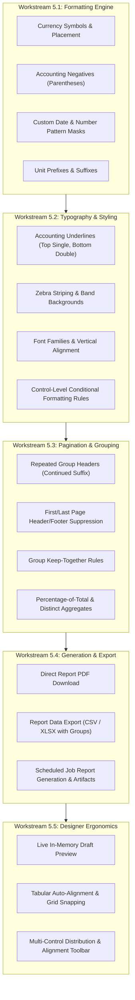

# Phase 5: Banded Report Formatting, Pagination & Generation Refinements

- **Target Release:** `v1.4.0` / `v1.5.0` (Minor Release)
- **Status:** Planning / Architecture Review
- **Milestone:** UX & Engine Refinement Phase 5
- **Related ADRs:** [ADR 0006: pdfjs-dist Test Dependency](../adr/0006-pdfjs-test-dependency.md), [ADR 0010: Geographic Fields](../adr/0010-geo-fields.md), [ADR 0011: File Attachments](../adr/0011-file-attachments.md), [ADR 0013: Backend-Agnostic SQL Layer](../adr/0013-backend-agnostic-sql-layer.md), [ADR 0015: Web UI Modernisation](../adr/0015-web-ui-review-and-modernisation.md)
- **Design Guidelines:** `web/src/components/DESIGN.md`

---

## 1. Executive Summary & Problem Space

AbiData provides a banded report engine inspired by Microsoft Access and modern publishing tools. Builders design reports structured into horizontal bands (Report Header, Page Header, Group Headers/Footers, Detail, Page Footer, Report Footer) with multi-level grouping, summary aggregates, vector maps, and attachment image galleries. Reports stream from Go as NDJSON section instances, paginate client-side against exact paper geometry (`@page`), and print or export via browser PDF printing.

While the baseline report engine is performant (streaming 10,000 rows and paginating in ~0.5s), production business reporting—such as financial ledgers, audit invoices, inventory summaries, and operational printouts—requires deeper formatting fidelity, more intelligent page composition, direct export capabilities, and authoring ergonomics.

### Key Limitations in Current System
1. **Formatting Rigidity:**
   - Currency is hardcoded to comma-separated two-decimal strings (`thousands(d.StringFixed(2))`) without locale or currency symbol customization (`$`, `€`, `£`, etc.).
   - Date and time formatting is restricted to fixed `short`/`medium`/`long` tokens with no custom pattern masks or localized ordering.
   - Negative numbers lack accounting styling (such as parentheses `(1,234.50)` or conditional danger red coloring).
2. **Typography & Styling Constraints:**
   - Controls support only basic font size, text alignment, and single-thickness box borders. They lack accounting underlines (single top border, double bottom border on totals), font family selection (serif/sans/mono), and vertical text alignment.
   - Bands have uniform white backgrounds without zebra striping or alternating row shading, hindering scanning on wide tabular reports.
   - No conditional formatting rules exist on report controls to highlight thresholds or anomalies.
3. **Pagination & Grouping Blind Spots:**
   - When large groups span multiple pages, subsequent pages show detail rows without repeating the group header, losing context.
   - Page headers/footers cannot be suppressed on the first page (cover/title page) or last page.
   - Aggregates are limited to standard `sum`, `avg`, `count`, `min`, and `max`, lacking percentage-of-total or distinct counts.
4. **Generation & Export Friction:**
   - PDF generation relies exclusively on manual browser `window.print()` dialogs; there is no direct 1-click download or server/job-driven export.
   - Flattened report data with evaluated calculations and group levels cannot be exported directly to CSV or Excel (`.xlsx`).
   - Designer preview requires committing a database save before testing changes.

---

## 2. Workstream Architecture & Technical Breakdown



---

## 3. Workstream 5.1: Extended Formatting Engine (Currency, Numbers & Dates)

### 3.1 Currency & Number Formatting Enhancements
Extend `internal/reports/service.go` and `web/src/features/reports/designer/reportModel.ts`:

- **Currency Configuration:**
  - Control properties:
    ```go
    type CurrencyOptions struct {
        Symbol    string `json:"symbol,omitempty"`     // "$", "€", "£", "¥", "CHF", etc. (default: workspace currency or "$")
        Placement string `json:"placement,omitempty"`  // "prefix" | "suffix" (default: "prefix")
        Spaced    bool   `json:"spaced,omitempty"`     // whether space separates symbol from number ("100 €" vs "€100")
        Negative  string `json:"negative,omitempty"`   // "minus" (-$100), "paren" (($100)), "sign_after" ($100-)
        Decimals  int    `json:"decimals,omitempty"`   // default: 2
    }
    ```
- **Custom Pattern Masks:**
  - Support Excel/Access-style pattern format strings: e.g. `#,##0.00;(#,##0.00);"-"`.
  - Date/time format tokens: e.g. `YYYY-MM-DD`, `DD/MM/YYYY`, `MM/DD/YYYY`, `MMM D, YYYY`, `YYYY-MM-DD HH:mm:ss`.
- **Prefix and Suffix Tokens:**
  - Allow controls to define optional `prefix` and `suffix` strings rendered alongside formatted values (e.g. `prefix: ""` / `suffix: " units"` or `suffix: " kg"`).

---

## 4. Workstream 5.2: Typography, Borders & Visual Styling

### 4.1 Accounting & Ledger Underlines
In accounting and financial reports, totals require specific border conventions:
- Summary row: Top border 1px solid, bottom border 1px solid.
- Grand total row: Top border 1px solid, bottom border 3px double (`border-double`).
- Expand `ReportControl.Style` to support explicit border edges:
  ```ts
  export interface ControlStyle {
    border_top?: "solid" | "dashed" | "double" | "none";
    border_bottom?: "solid" | "dashed" | "double" | "none";
    border_color?: string;
    border_width?: number; // px (1, 2, 3)
  }
  ```

### 4.2 Alternating Row Shading (Zebra Striping) & Band Fills
- Band-level property on `Detail`:
  - `alternate_background?: string` (e.g. subtle theme token `var(--paper-zebra)` / `#f9fafb`).
  - Evaluated in `BandView.tsx`: odd detail rows render clean white; even detail rows render the alternate tint.
- Band-level background colors:
  - Header and footer bands can define background fills (e.g. muted group header band) to clearly distinguish hierarchical sections.

### 4.3 Font Families & Vertical Alignment
- `font_family`: `"sans"` (Inter/system), `"serif"` (Charter/Georgia), `"mono"` (JetBrains Mono/Menlo).
- `vertical_align`: `"top"` (default), `"middle"`, `"bottom"`.
- `text_decoration`: `"none"`, `"underline"`, `"line-through"`.

### 4.4 Report Control Conditional Formatting
Bring the declarative rule engine from Datasheet (Phase 4) into Report Controls:
- Evaluated per instance during run resolution in Go or client rendering:
  - Rule condition: `operator` (`<`, `<=`, `>`, `>=`, `=`, `!=`, `is_empty`, `is_not_empty`) against `target_value` or Lua expression.
  - Applied style overrides: `text_color` (e.g. `var(--danger)` / `#dc2626`), `bold`, `background_color`.
  - Accessible label automatically generated for screen readers.

---

## 5. Workstream 5.3: Pagination & Grouping Engine Refinements

### 5.1 Repeat Group Header on Page Break
- **Problem:** When a group's detail records span multiple pages (e.g. 5 pages of orders for "Customer Acme Corp"), pages 2 through 5 show detail rows without the group context.
- **Specification:**
  - Group property: `repeat_header: boolean` (default: false).
  - When true, if a page break occurs inside a group, the paginator automatically inserts a clone of the group header at the top of the body of the new page.
  - Optional `continued_suffix?: string` (default: `" (continued)"`) appended to the primary label or displayed in an indicated sub-control.

### 5.2 Header / Footer Page Suppression
- Properties on `page_header` and `page_footer`:
  - `suppress_first_page: boolean` (useful for reports with a dedicated report header / cover page).
  - `suppress_last_page: boolean`.
- Handled natively in `paginate.ts` by checking `page.number === 1` and `page.number === pageCount`.

### 5.3 Group Keep-Together
- Group property `keep_together: "none" | "first_detail" | "all"`.
  - `"first_detail"`: Ensures group header is never orphaned without at least one detail row (already partially guarded, now formalized).
  - `"all"`: If the entire group (header + all detail rows + footer) fits on a single fresh page, moves the whole group to the next page instead of splitting it across pages.

### 5.4 Advanced Aggregates
- Add to `Aggregate.Func`:
  - `"count_distinct"`: Unique non-null values of the bound column.
  - `"percent_of_total"`: Ratio of the current group's sum to the grand report sum.

---

## 6. Workstream 5.4: Generation, Export & Background Automation

### 6.1 Direct 1-Click PDF Download
- Provide a direct "Download PDF" action in the `ReportViewer` toolbar alongside "Print".
- Generates high-fidelity vector PDF matching `@page` dimensions without opening system printer dialogs.

### 6.2 Structured Data Export from Reports (CSV & Excel)
- Add "Export Data" button with format choices:
  - **Flattened CSV / Excel (.xlsx):** Includes hierarchical group keys as leading columns, detail rows, and calculated control expressions.
  - **JSON Records:** Hierarchical JSON tree mirroring groups and records.

### 6.3 Background Job Report Generation
- In Lua scripts (`internal/script/modules/` or jobs):
  - `reports.generate(report_id, params, options)`:
    - Runs the report, renders output, and persists it to `internal/artifacts`.
    - Enables automated nightly sales reports, weekly inventory summaries, and compliance archives.

---

## 7. Workstream 5.5: Designer Ergonomics & Live Draft Preview

### 7.1 In-Memory Live Draft Preview
- Allow the designer's "Preview" tab to execute against the current unsaved state by passing draft layout/page setup in the run payload, removing the mandatory "Save to preview" friction.

### 7.2 Multi-Control Alignment & Distribution Toolbar
- When multiple controls are selected on the canvas:
  - Alignment buttons: Align Left, Align Right, Align Top, Align Bottom, Align Centers.
  - Equalize Width / Equalize Height.
  - Distribute horizontally / vertically with equal spacing.

### 7.3 Tabular Layout Column Synchronization
- Adding or moving controls in the Page Header automatically snaps and resizes corresponding detail row columns to maintain exact vertical alignment.

---

## 8. Rollout Plan & Phased Milestones

| Milestone | Scope | Deliverables |
|---|---|---|
| **5.1 Formatting Fidelity** | Custom currency, pattern masks, prefixes/suffixes, accounting negatives | Updated `internal/reports/service.go`, `reportModel.ts`, unit tests |
| **5.2 Typography & Shading** | Accounting double underlines, zebra striping, font families, conditional styles | Updated `viewerLogic.ts`, `BandView.tsx`, `ReportProperties.tsx` |
| **5.3 Intelligent Pagination** | Repeat group headers with `(continued)`, first-page suppression, group keep-together | Updated `paginate.ts`, `paginate.test.ts`, E2E specs |
| **5.4 Generation & Export** | Direct PDF download, flattened CSV/XLSX export, Lua `reports.generate` | New export handler, artifact integration, Playwright verification |
| **5.5 Designer Ergonomics** | Live draft preview, multi-control alignment toolbar, tabular auto-snap | Designer UI updates, visual canvas tools |

---

## 9. Verification & Quality Gates

1. **Unit & Paginator Tests (`vitest`):**
   - Test custom currency and pattern masks across positive, negative, and zero values.
   - Test repeat group header insertion on multi-page splits in `paginate.test.ts`.
   - Test first/last page header suppression edge cases.
2. **Go Regression & Invariant Tests (`go test ./internal/reports/...`):**
   - Stream golden assertions validating formatting output.
   - Resource and memory bounds checking under 200,000-row streams.
3. **End-to-End Playwright Tests (`tests/e2e/reports.spec.ts`):**
   - Multi-page grouped report verifying repeated headers with `(continued)`.
   - Direct export download tests asserting generated PDF and CSV file contents.
   - Axe accessibility validation across all new designer properties and viewer dialogs.
