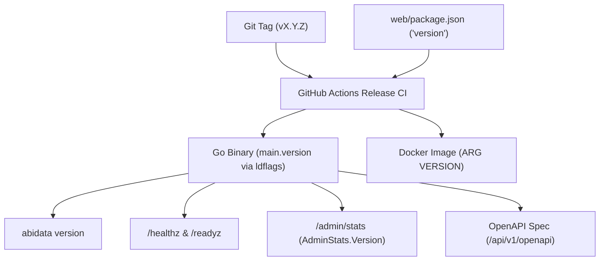

# Project-Wide Semantic Versioning (SemVer) & Release Policy

- **Status:** Active & Mandatory
- **Effective Date:** October 2026
- **Applies To:** Entire AbiData repository (`cmd/abidata`, `internal/`, `web/`, Docker, CLI, APIs)
- **Reference Standard:** [Semantic Versioning 2.0.0 (semver.org)](https://semver.org/spec/v2.0.0.html)

---

## 1. Core Principles & Philosophy

AbiData strictly adheres to **Semantic Versioning 2.0.0**. Because AbiData is distributed as a single self-contained binary packaging both backend and web frontend, as well as multi-architecture container images, versioning is **project-wide and synchronized across all subsystems**.

### 1.1 The Golden Rule: Every Merge to `main` Increments SemVer

> [!IMPORTANT]
> **All changes landing on the `main` branch must increment SemVer project-wide.**
> There are no unversioned merges on `main`. Every Pull Request merged into `main` must bump the project version (a patch increment `1.X.Y` → `1.X.Y+1`) and record its change under `[Unreleased]` in `CHANGELOG.md`, so every commit on `main` is an identifiable, reproducible build.

### 1.1.1 What Gets Released

Releases (a `vX.Y.Z` tag, the GitHub Release, binaries and container images) are cut only:
- **on minor versions**, when a milestone is complete (`1.4.7` → `1.5.0`); and
- **on special fix patch versions**, when a security fix or serious regression cannot wait for the next minor. The fix lands on `main` with its normal patch bump and that patch version is tagged (see §5).

The patch versions in between are versioned builds of `main`, not releases.

### 1.2 Version Structure: `MAJOR.MINOR.PATCH`

1. **MAJOR (`X.0.0`)**: Incompatible breaking changes.
   - Breaking modifications to the REST API (`/api/v1`) without backwards compatibility.
   - Incompatible alterations or removals in sandboxed Lua host APIs.
   - Workspace storage format or platform database schema changes requiring manual administrator intervention or non-automatic data migration.
   - Breaking CLI syntax changes or removals of core environment variables.
2. **MINOR (`1.X.0`)**: Backward-compatible new functionality & milestone phases.
   - **Each completed UX refinement phase represents a Minor version bump**:
     - **`v1.1.0`**: Phase 1 — Query Console Ergonomics & Datasheet Selection Aggregation.
     - **`v1.2.0`**: Phase 2 — Information Clarity & Team Collaboration (Filter Pills, Rich Messaging, Cross-Workspace Palette).
     - **`v1.3.0`**: Phase 3 — Mobile Touch Fluidity & Form Composition (Record Swipe Gestures, Accordion Sections).
     - **`v1.3.1`**: Phase 4 — Advanced Data Exploration & Deep Datasheet Ergonomics (Quick Add, Multi-Sort, Freezing, Clipboard), shipped early in a 1.3 patch release.
     - **`v1.4.0`**: Reports, clipboard interchange, typed Excel export, the Sylvan Atelier theme and mobile touch ergonomics (ADRs 0018-0022).
     - **`v1.5.0`**: Theme cohesion and UI polish (ADR 0023) and the October 2026 security review fixes.
   - Additive REST endpoints and optional query/body parameters in `/api/v1`.
   - Additive Lua host modules, functions, or analytical libraries.
   - Backward-compatible automated schema migrations applied seamlessly on startup.
3. **PATCH (`1.0.X`)**: Backward-compatible bug fixes, refactors, and incremental changes.
   - Incremental PR merges and stepping stones towards milestone releases.
   - Defect and regression repairs.
   - Performance optimizations and security patches.
   - Documentation updates and developer tooling improvements.

---

## 2. Release & Versioning Roadmap

| Version | Milestone / Scope | Status | Planning Document |
|---|---|---|---|
| **`v1.0.0`** | Initial General Availability Release | Released | [CHANGELOG.md](../../CHANGELOG.md#100---2026-10-20) |
| **`v1.0.1`+** | Incremental PRs, bug fixes, performance, stepping stones | In Progress | Patch version per PR; released only as special fix releases (§5) |
| **`v1.1.0`** | **Phase 1:** Query Console Power (`Mod+Enter`, Monaco SQL, Error Markers) & Selection Aggregation | Completed | [phase-1-query-grid-power.md](phase-1-query-grid-power.md) |
| **`v1.2.0`** | **Phase 2:** Filter Pills Bar, Rich Thread Messaging & Cross-Workspace Palette | Completed | [phase-2-clarity-and-collaboration.md](phase-2-clarity-and-collaboration.md) |
| **`v1.3.0`** | **Phase 3:** Mobile Touch Swipe Gestures, iOS Keyboard Dismissal & Form Accordions | Completed | [phase-3-mobile-touch-and-forms.md](phase-3-mobile-touch-and-forms.md) |
| **`v1.3.1`** | **Phase 4:** Pinned Quick Add, Multi-Sort Badges, Column Freezing & Range Clipboard (shipped early in a 1.3 patch) | Released | [phase-4-data-exploration-and-datasheet.md](phase-4-data-exploration-and-datasheet.md) |
| **`v1.4.0`** | Report bands and PDF output, clipboard interchange, typed Excel export, the Sylvan Atelier theme and mobile touch ergonomics | Released | [ADRs 0018-0022](../adr/0000-record-of-decisions.md) |
| **`v1.5.0`** | Theme cohesion and UI polish, security review fixes | Released | [ADR 0023](../adr/0023-theme-cohesion-and-ui-polish.md) |

---

## 3. Single Source of Truth for Version Metadata

To prevent version skew between components, version metadata is centrally tracked and synchronized across five core artifacts:



### 3.1 Metadata Manifests

1. **Frontend Package Manifest (`web/package.json`):**
   - The `"version"` field in `web/package.json` reflects the active SemVer (e.g. `"version": "1.0.1"`).
   - Bumped in the PR commit that lands on `main`.
2. **Go Executable Metadata (`main.version` in `cmd/abidata/main.go`):**
   - Default fallback variable: `var version = "dev"`.
   - Build-time injection via Go `-ldflags`:
     ```sh
     go build -trimpath -ldflags "-s -w -X main.version=${TAG_VERSION}" ./cmd/abidata
     ```
   - Exposed programmatically to:
     - CLI command `abidata version`.
     - OpenAPI definition via Huma `huma.DefaultConfig("AbiData API", deps.Version)`.
     - Admin dashboard metrics `/api/v1/admin/stats` (`AdminStats.Version`).
     - Backup manifest metadata (`backup.Service.AppVersion`).
3. **Container Image Labels (`Dockerfile`):**
   - Passed via build argument: `ARG VERSION=dev`.
   - Tagged as `ghcr.io/abishyoung/abidata:vX.Y.Z` and `ghcr.io/abishyoung/abidata:latest` (on major/minor milestones).
4. **Changelog (`CHANGELOG.md`):**
   - Maintained under the [Keep a Changelog](https://keepachangelog.com/) standard.
   - PRs add their entries under `## [Unreleased]`; every *released* version has an explicit section with release date: `## [X.Y.Z] - YYYY-MM-DD`.

---

## 4. Step-by-Step Release Verification & Execution Checklist

When preparing a release (a completed milestone minor release, or a special fix patch release):

### Step 1: Pre-Release Verification (Local Clean State)
Run all verification gates locally before cutting the release branch or merging the PR:
```sh
# 1. Full repository linting
make lint

# 2. Frontend typecheck and unit tests
npm --prefix web run typecheck
npm --prefix web run lint
npm --prefix web run test

# 3. Go unit and integration tests
go test -short ./...
go test -race ./internal/httpapi/... ./cmd/...

# 4. In-app documentation and link integrity check
go test ./internal/docsrv/...

# 5. Playwright e2e validation (desktop & mobile)
make e2e
```

### Step 2: Synchronize Version Manifests
1. **Update `web/package.json`**:
   Update `"version": "X.Y.Z"` to match the new release.
2. **Update `CHANGELOG.md`**:
   - Move all completed items from `[Unreleased]` into a new heading: `## [X.Y.Z] - YYYY-MM-DD`.
   - Update comparison links at the bottom:
     ```markdown
     [Unreleased]: https://github.com/AbishYoung/AbiData/compare/vX.Y.Z...HEAD
     [X.Y.Z]: https://github.com/AbishYoung/AbiData/releases/tag/vX.Y.Z
     ```
3. **Update `README.md`**:
   Ensure the version badge points to the new version:
   ```markdown
   [](https://github.com/AbishYoung/AbiData/releases)
   ```

### Step 3: Commit and Merge to `main`
Commit the version synchronization cleanly:
```sh
git add web/package.json CHANGELOG.md README.md
git commit -m "chore(release): bump version to vX.Y.Z"
git push origin main
```

### Step 4: Tag the Release
Create an annotated Git tag on the clean `main` commit and push:
```sh
git tag -a vX.Y.Z -m "Release vX.Y.Z"
git push origin vX.Y.Z
```

### Step 5: Automated GitHub Actions Pipeline
Pushing the `v*.*.*` tag automatically triggers `.github/workflows/release.yml`:
1. **Test Gate:** Executes `npm test` and `go test -short ./...`.
2. **Web Asset Build:** Generates optimized SPA distribution assets in `web/dist`.
3. **Binary Compilation:** Injects `main.version=${TAG_VERSION}` across all 5 supported OS/arch matrices:
   - `linux/amd64`
   - `linux/arm64`
   - `darwin/amd64`
   - `darwin/arm64`
   - `windows/amd64 (.exe)`
4. **Integrity Checksums:** Generates `sha256sums.txt` for all compiled binaries.
5. **GitHub Release Publication:** Creates published release with attached binaries, checksums, and notes.
6. **Container Image Distribution:** Builds and pushes multi-architecture images to GitHub Packages / container registry.

---

## 5. Special Fix (Patch) Release Workflow

If a critical security vulnerability or serious regression is found and the fix cannot wait for the next minor release:
1. Branch from the latest `main`: `git checkout -b fix/<short-name> origin/main`.
2. Apply the surgical fix and add a targeted regression test.
3. Verify it passes: `go test ./...` and `npm test`.
4. Bump `web/package.json` to the next patch above `main` (`X.Y.Z` → `X.Y.Z+1`).
5. Move `[Unreleased]` (including the fix, under `### Security` or `### Fixed`) into `## [X.Y.Z+1] - YYYY-MM-DD`, since this patch version is released.
6. Merge to `main` once CI is green.
7. Cut and push tag `vX.Y.Z+1` on that merge commit (Step 4 above).

Security fixes follow [SECURITY.md](../../SECURITY.md) for disclosure: the advisory is published once the release is out.

---

## 6. Policy Enforcement & Auditing

- **CI Check:** Every PR build validates that `web/package.json` version matches expected SemVer constraints and that `CHANGELOG.md` contains an entry describing the changes.
- **Docs Server Audit:** `go test ./internal/docsrv/...` verifies that any version references in embedded documentation resolve accurately and that no broken links exist.
