# Specification & Plan: Visual Design & Style Overhaul ("Adding Spice & Life")

- **Target Release:** `v1.5.0` (or Visual Polish Milestone)
- **Status:** Planning / Design Architecture Review
- **Design Philosophy:** "Add spice rather than change ingredients" — Preserve 100% of information architecture, DOM accessibility roles, and keyboard navigation while elevating visual craft, material depth, typography, tactile micro-details, and alive system activity animations.
- **Related Documents:** [ADR 0015: Web UI Modernisation](../adr/0015-web-ui-review-and-modernisation.md), [DESIGN.md](../../web/src/components/DESIGN.md)

---

## 1. Executive Summary & Design Vision

AbiData is functionally mature, highly capable, and accessible (WCAG AA compliant). However, its current aesthetic feels "very default" — relying on standard flat Tailwind/shadcn neutrals, unstyled 1px borders, uniform gray backgrounds, static indicators, and utilitarian controls. Furthermore, when the system is executing queries, streaming reports, or running background jobs, feedback is often limited to a simple rotating spinner or static text.

This overhaul introduces **craft, personality, tactile refinement, and alive motion design** without altering the underlying layout or breaking user muscle memory:
- **Keep the Ingredients:** The navigation pane, tab strip, document toolbars, datasheet grids, Radix dialogs, and keyboard shortcuts remain structurally identical.
- **Add the Spice & Life:**
  1. **Atmospheric Surface Layering:** Specular top-edge micro-highlights, translucent frosted glass chrome (`backdrop-blur-md`), and deep obsidian/graphite dark-mode color grading.
  2. **Tactile Micro-Craft:** Directional button gradients, crisp inner-shadow bevels, floating recessed segmented pill trays, and tactile button press scaling (`active:scale-[0.98]`).
  3. **The "Jewel" Object System:** Upgrading flat kind tags (Tables, Queries, Forms, Reports, Scripts, Jobs) into rich, satin-gradient jewel pills with tinted micro-borders and distinctive radiance.
  4. **The Cockpit Shell & Tab Strip:** Glowing left-edge active indicators in navigation, elevated active tabs with dirty-state pulse indicators, and refined status bar chips.
  5. **High-Performance Data Console:** Satin-sheen datasheet headers, diffused shadow dividers on frozen columns, and precision cell focus outlines.
  6. **"System is Alive" Motion & Activity Engine:** Breathing server heartbeats, ambient laser progress beams on data streaming, smooth numeric row tickers, shimmer-wave skeletons, and save-confirmation ripples.

---

## 2. Design Pillars & Visual Architecture

```mermaid
flowchart TD
    subgraph P1["1. Atmospheric Materials"]
        M1["Specular Micro-Borders (inset 0 1px 0)"]
        M2["Frosted Glass Chrome (backdrop-blur-md)"]
        M3["Obsidian & Titanium Neutral Palettes (OKLCH)"]
        M4["Diffused Multi-Layer Shadows"]
    end

    subgraph P2["2. Tactile Controls"]
        C1["Primary Gradient Buttons with Top Highlight"]
        C2["Floating Recessed Segmented Trays"]
        C3["Illuminated Hover Borders"]
        C4["Tactile Press Feedback (active:scale-[0.98])"]
    end

    subgraph P3["3. The Jewel Kind System"]
        J1["Sapphire Tables & Amethyst Queries"]
        J2["Emerald Forms & Topaz Reports"]
        J3["Turquoise Scripts & Ruby Jobs"]
        J4["Satin Fill Gradients + Tinted Borders"]
    end

    subgraph P4["4. Shell & Data Console"]
        S1["Glowing Navigation Active Indicator"]
        S2["Elevated Active Tab with Accent Anchor"]
        S3["Diffused Frozen Column Shadow Divider"]
        S4["Precision Cell Focus Rings with Subtle Radius"]
    end

    subgraph P5["5. System is Alive (Motion Engine)"]
        A1["Breathing Heartbeat Beacon (SSE Live State)"]
        A2["Laser Progress Beam (Query & Report Streaming)"]
        A3["Mutation Wave & Save Ripples (Datasheet & Forms)"]
        A4["Shimmer-Wave Skeletons & Animated Number Tickers"]
    end

    P1 --> P2
    P2 --> P3
    P3 --> P4
    P4 --> P5
```



---

## 3. Workstream Breakdown

### Workstream 1: Design Tokens & Material Craft (`tokens.css`)

#### 1.1 Color Grading & The "Obsidian Studio" Dark Mode
Upgrade color coordinates in `web/src/styles/tokens.css` while maintaining strict WCAG AA contrast ratios:
- **Dark Theme (`--bg`, `--surface`, `--surface-2`, `--surface-3`):**
  - Shift from flat neutral-900 gray to **Obsidian Studio Graphite**:
    - Deep base background: `oklch(15.2% 0.016 274)` (velvety deep graphite with a whisper of midnight blue).
    - Surface 1 (panels/cards): `oklch(18.8% 0.018 272)`.
    - Surface 2 (toolbars/headers): `oklch(22.4% 0.021 270)`.
    - Surface 3 (hover/active): `oklch(26.2% 0.024 268)`.
- **Light Theme:**
  - Shift from cold stark gray to **Clean Alabaster / Titanium**:
    - Base background: `oklch(97.8% 0.003 260)`.
    - Pure white surfaces with refined contrast boundaries.

#### 1.2 Specular Highlights & Precision Micro-Borders
Introduce CSS custom properties for physical lighting on edges:
```css
/* Light mode: crisp white top reflection */
--specular-highlight: inset 0 1px 0 0 rgba(255, 255, 255, 0.75);
--specular-border: 1px solid oklch(91% 0.008 258);

/* Dark mode: delicate glass reflection */
--specular-highlight: inset 0 1px 0 0 rgba(255, 255, 255, 0.08);
--specular-border: 1px solid oklch(28% 0.02 268);
```

#### 1.3 Frosted Glass Translucency
Apply backdrop filters to top chrome:
- Shell Header: `bg-surface/85 backdrop-blur-md border-b border-border/80`.
- Document Toolbar: `bg-surface/90 backdrop-blur-sm border-b border-border/70`.
- Navigation Drawer & Dialog Overlays: Deep scrim with refined progressive blur (`backdrop-blur-sm`).

#### 1.4 Diffused Multi-Layer Shadows
Upgrade `--shadow-*` tokens:
- `--shadow-sm`: `0 1px 2px -1px rgba(0,0,0,0.06), 0 1px 3px 0 rgba(0,0,0,0.04)`.
- `--shadow-md`: `0 4px 16px -2px var(--shadow-color-2), 0 2px 6px -1px var(--shadow-color-1)`.
- `--shadow-lg`: `0 20px 48px -12px var(--shadow-color-3), 0 8px 16px -4px var(--shadow-color-2)`.
- `--shadow-accent`: `0 4px 14px -1px var(--color-accent-soft)`.

---

### Workstream 2: Component Micro-Craft (`components/styles.ts`, `components/ui/`)

#### 2.1 Buttons & Interactive Elements
- **`btnPrimary`**:
  - Gradient: `bg-gradient-to-b from-accent to-[oklch(47%_0.21_277)] text-accent-fg`.
  - Edge craft: `shadow-[inset_0_1px_0_0_rgba(255,255,255,0.22),0_1px_2px_rgba(0,0,0,0.1),0_4px_12px_-2px_var(--color-accent-soft)]`.
  - Micro-interaction: `hover:brightness-105 active:scale-[0.98] transition-all duration-150`.
- **`btn` (Secondary)**:
  - Surface: `bg-gradient-to-b from-surface to-surface-2/60 border border-border shadow-[inset_0_1px_0_0_rgba(255,255,255,0.06),0_1px_2px_rgba(0,0,0,0.04)]`.
  - Hover: `hover:border-border-strong/60 hover:from-surface-2 hover:to-surface-2 active:bg-surface-3 active:scale-[0.98]`.
- **`btnGhost`**:
  - Crisp text with silky hover pill transition (`hover:bg-surface-2/70 text-fg-muted hover:text-fg`).

#### 2.2 Segmented Pill Switchers (Views & Density)
Upgrade view toggles (`Datasheet | Design | SQL`):
- Container: Recessed tray `inline-flex p-0.5 rounded-lg bg-surface-3/60 border border-border/50 backdrop-blur-xs`.
- Active Pill: Floating card `bg-surface text-fg font-medium shadow-xs rounded-md border border-border/40 transition-all`.
- Inactive Pill: `text-fg-muted hover:text-fg transition-colors`.

#### 2.3 Search Inputs & Keyboard Shortcuts
- Search field: Inset background with subtle leading icon tint and smooth focus outline ring.
- Keyboard shortcut caps (`kbd`):
  - Refined rounded pill: `inline-flex h-5 items-center px-1.5 rounded font-mono text-[11px] font-medium bg-surface-2/80 border border-border/70 text-fg-subtle shadow-[0_1px_0_rgba(0,0,0,0.05)]`.

---

### Workstream 3: The "Jewel" Object System (`components/objectKinds.tsx`)

#### 3.1 Object Kind Palettes & Micro-Gradients
Elevate the wayfinding colors across all six core entity kinds:
- **Table:** Sapphire Blue (`oklch(56% 0.22 262)`)
- **Query:** Amethyst Violet (`oklch(55% 0.25 294)`)
- **Form:** Emerald Jade (`oklch(60% 0.16 162)`)
- **Report:** Topaz Amber (`oklch(58% 0.18 42)`)
- **Script:** Turquoise Cyan (`oklch(54% 0.14 220)`)
- **Job:** Coral Rose (`oklch(54% 0.21 4)`)

#### 3.2 The Jewel Badge Component
Replace flat kind tags with satin jewel badges:
```tsx
<span className="inline-flex items-center gap-1.5 rounded-full px-2.5 py-0.5 text-xs font-medium border border-kind-[x]/25 bg-gradient-to-b from-kind-[x]-soft/90 to-kind-[x]-soft/40 text-kind-[x] shadow-xs">
  <KindIcon kind={kind} size="sm" />
  {name}
</span>
```

---

### Workstream 4: Shell Cockpit & Navigation Polish (`WorkspaceShell.tsx`, `NavPane.tsx`)

#### 4.1 Sleek Navigation Pane
- **Active Navigation Item:**
  - Introduce an illuminated vertical accent anchor: `absolute left-0 top-1/2 -translate-y-1/2 w-1 h-3.5 rounded-full bg-accent shadow-[0_0_8px_var(--color-accent)]`.
  - Pill background: subtle satin gradient `bg-accent-soft/80 border border-accent/15`.
  - Text: crisp medium weight with accent hue.
- **Section Headers & Eyebrows:**
  - `text-[11px] font-semibold uppercase tracking-wider text-fg-subtle flex items-center justify-between`.
  - Smooth 90-degree chevron rotation on collapse/expand.

#### 4.2 Elevated Tab Strip
- Inactive tabs: Clean muted text with subtle hover background.
- Active tab:
  - Elevated background with distinct top-edge highlight bar (`border-t-2 border-accent`).
  - Subtle drop shadow separating tab from toolbar.
  - Unsaved change indicator ("dirty tab"): Pulsing glowing amber jewel dot (`w-1.5 h-1.5 rounded-full bg-warning shadow-[0_0_6px_var(--color-warning)]`).

---

### Workstream 5: Datasheet Data Console Aesthetics (`Grid.tsx`, `DatasheetView.tsx`)

#### 5.1 Header Row Refinement
- Header cells: Subtle satin gradient fill, crisp hairline column divider (`border-r border-border/70`), and bold text.
- Sort rank badges: High-contrast rounded pill (`1 ▲`, `2 ▼`) with subtle indigo border.
- Column resize handle: Hover illumination with glowing vertical line.

#### 5.2 Row Aesthetics & Cell Focus
- Hover row: Satin wash `bg-surface-2/60 transition-colors duration-100`.
- Selected rows: Sleek tinted fill `bg-accent-soft/50` with high contrast.
- Active cell: Crisp 2px focus ring with 3px border-radius (`rounded-[3px] ring-2 ring-focus ring-offset-0`).
- Frozen Column Shadow: Soft, diffused vertical shadow separator (`shadow-[3px_0_10px_-2px_rgba(0,0,0,0.12)]`).

---

### Workstream 6: "System is Alive" Motion & Activity Engine

#### 6.1 Breathing Connection Beacon (`WorkspaceShell.tsx`)
In the shell header, replace the static status circle with an ambient breathing beacon:
- **`live`**: A glowing green core with a soft periodic pulse ring (`relative flex h-2.5 w-2.5`: inner `rounded-full bg-success`, outer `absolute inline-flex h-full w-full animate-ping rounded-full bg-success opacity-30`).
- **`reconnecting`**: Amber double-pulse breathing animation.
- **`offline`**: Steady muted rose indicator.
- Conveys that the background SSE stream is live and listening.

#### 6.2 Top-Edge Laser Progress Beam
When queries execute, reports stream, or imports process:
- Render a micro-height progress laser beam (`h-[2px] w-full fixed top-0 left-0 z-50 overflow-hidden`):
  - Gradient: `bg-gradient-to-r from-accent via-indigo-400 to-cyan-400`.
  - Indeterminate animation: Smooth left-to-right sliding gradient glow (`animate-indeterminate-beam`).
  - Signals immediate system responsiveness without cluttering the main canvas with intrusive full-screen spinners.

#### 6.3 Animated Numeric Counter Tickers
When row counts or search matches update:
- Smooth tabular figure transitions: Numbers smoothly increment rather than jumping instantaneously, giving tangible proof of background ingestion streaming.

#### 6.4 Save Ripple & Mutation Highlights
- When a record is created (via Quick Add or modal paste) or updated:
  - The modified row receives an ephemeral, elegant satin highlight sweep (`bg-accent-soft/40 -> transparent` over 1,200ms).
  - Eliminates doubt about whether a save committed.
- When an external user modifies a row over SSE:
  - An amber-tinted pulse ripples over the changed cell, visually demonstrating multi-user real-time collaboration.

#### 6.5 Shimmer-Wave Skeletons
- Upgrade standard pulsing gray blocks (`animate-pulse`) with a diagonal light-sweep shimmer:
  - `bg-gradient-to-r from-surface-3 via-surface-2 to-surface-3 bg-[length:200%_100%] animate-shimmer-sweep`.
  - Looks polished, intentional, and high-tech during cold starts.

#### 6.6 Fluid Surface Staging (Dialogs, Menus & Tooltips)
- **Modals & Dialogs:** Smooth scale-and-fade entrance:
  `data-[state=open]:animate-dialog-in data-[state=closed]:animate-dialog-out`
  (`transform: scale(0.97) -> scale(1.0); opacity: 0 -> 1` with `cubic-bezier(0.16, 1, 0.3, 1)` over 150ms).
- **Tooltips (`Tip`):** Soft fade with 2px vertical drift (`opacity: 0, translateY(2px) -> opacity: 1, translateY(0)` over 100ms).
- **Accordions & Navigation Groups:** Smooth height transitions using Radix CSS variables (`var(--radix-collapsible-content-height)`).

---

## 4. Implementation Phasing & Milestones

| Phase | Milestone | Deliverables | Target Files |
|:---|:---|:---|:---|
| **O1** | **Material & Token Elevation** | Obsidian dark mode coordinates, specular highlight tokens, diffused shadows | `tokens.css` |
| **O2** | **Tactile Control Craft** | Primary gradient buttons, micro-bevels, recessed segmented trays | `components/styles.ts`, `components/ui/` |
| **O3** | **Jewel Object Badges** | Satin jewel gradients, tinted borders, updated kind iconography | `objectKinds.tsx`, `tokens.css` |
| **O4** | **Cockpit Navigation & Tabs** | Illuminated active nav bar, elevated tabs, dirty pulse indicators | `NavPane.tsx`, `WorkspaceShell.tsx`, `navStyles.ts` |
| **O5** | **Datasheet Console Polish** | Satin headers, diffused frozen column shadow, cell focus outline | `Grid.tsx`, `DatasheetView.tsx` |
| **O6** | **"System is Alive" Motion Engine** | Breathing beacon, laser progress beam, save ripples, shimmer sweep | `tokens.css`, `WorkspaceShell.tsx`, `Editors.tsx` |

---

## 5. Non-Negotiable Invariants & Quality Gates

1. **Accessibility Gate (`make test-web` & `tests/e2e/a11y.spec.ts`):**
   - Zero WCAG AA contrast violations in either light or dark mode.
   - All interactive elements maintain visible focus outlines (`:focus-visible`).
   - `prefers-reduced-motion` suppresses all transitions and animations instantly via:
     ```css
     @media (prefers-reduced-motion: reduce) {
       *, *::before, *::after {
         animation-duration: 0.01ms !important;
         transition-duration: 0.01ms !important;
       }
     }
     ```
2. **DOM Stability & E2E Selector Immunity:**
   - Zero changes to `role`, `aria-label`, or accessible names.
   - All 35+ Playwright E2E suites pass without selector modifications.
3. **Performance Gate:**
   - Zero added runtime JavaScript dependencies (pure CSS keyframes and Tailwind utilities).
   - 10,000-row datasheet scrolling remains locked at 60 FPS.
